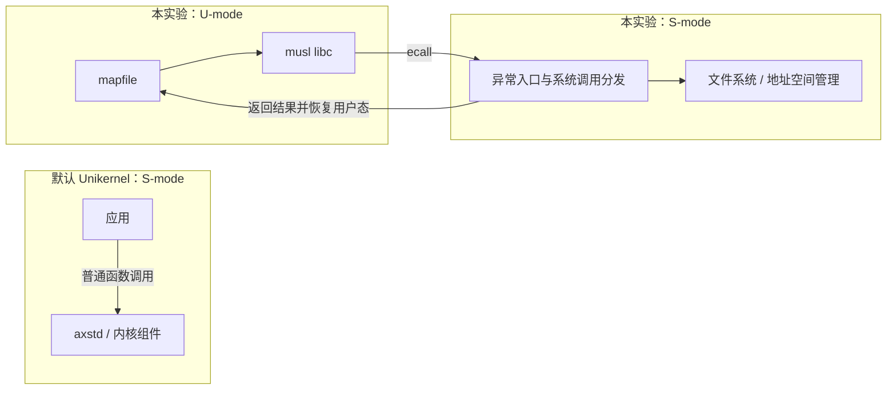
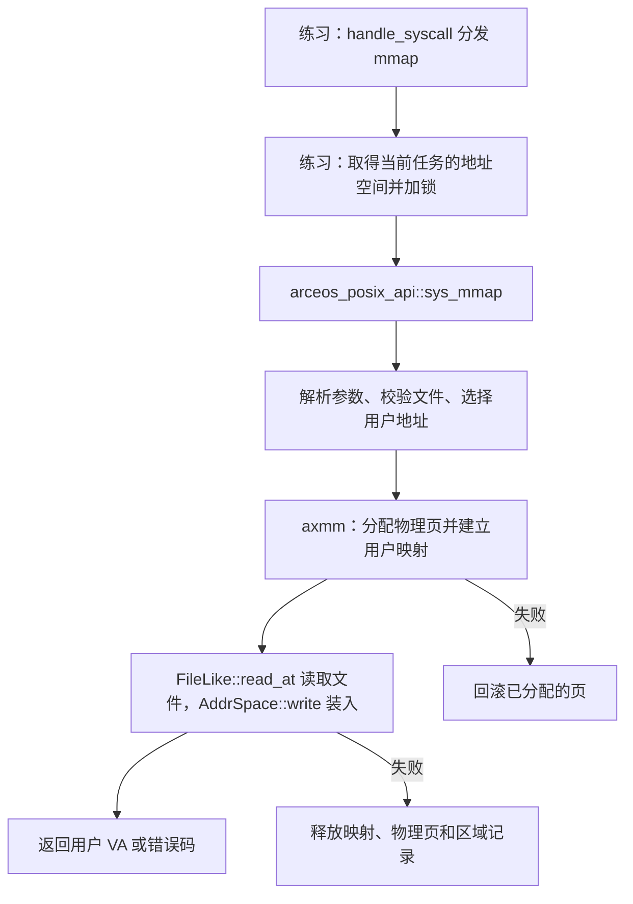
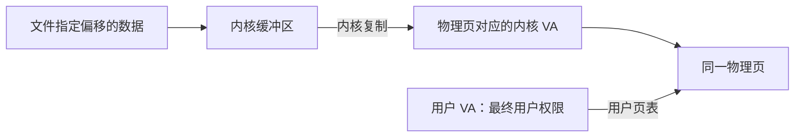

# sys_map 实验：用户态与系统调用

本实验在 ArceOS 组件上运行一个独立的用户态程序，通过系统调用实现文件映射。它与默认 Unikernel 应用的运行方式不同。

本文先说明用户程序如何通过 syscall 进入内核，再讲解本次文件映射实现的分层、依赖和资源管理。

## 1. 为什么 ArceOS 中还会出现 syscall

ArceOS 默认采用 Unikernel 方式：应用与内核组件链接到同一个镜像，运行于同一特权级，应用调用系统功能时通常直接调用函数。

但 ArceOS 的组件也可以被组合成支持用户态的运行环境。本实验就是这种组合：内核加载单独的用户 ELF，创建用户地址空间，进入用户态，并处理用户态系统调用。

| 项目 | 默认 Unikernel 应用 | 本实验的 mapfile 程序 |
| --- | --- | --- |
| 程序组织 | 应用与内核组件一起链接 | 内核加载独立 ELF |
| RISC-V 运行模式 | 应用随内核运行在 S-mode | 用户程序运行在 U-mode，内核运行在 S-mode |
| 使用系统功能 | 普通函数调用 | 用户 libc 发起 syscall，进入内核处理 |
| 地址空间 | 通常使用内核地址空间 | 建立用户区域映射，并包含受保护的内核映射 |

“用户写的应用代码”和“CPU 用户态代码”不是同一个概念。默认 Unikernel 的应用可以运行在内核态；本实验明确进入 CPU 用户态。



## 2. 谁在启动，谁在用户态运行

本实验依次经过三个执行环境：

```text
OpenSBI：M-mode 固件
    ↓ 将控制权交给 S-mode 内核
ArceOS：S-mode，执行 exercises/sys_map 的内核侧 main
    ↓ 加载 ELF、创建地址空间和任务
mapfile：U-mode，执行独立用户程序的 main
```

OpenSBI 将控制权交给 S-mode 内核后，内核还可以通过恢复用户上下文进入 U-mode。内核的启动特权级不决定所有后续程序的特权级。

本实验有两个不同的 `main()`：

- [exercises/sys_map/src/main.rs](../arceos/exercises/sys_map/src/main.rs)：内核侧，负责装载和启动用户任务。
- [payload/mapfile_c/mapfile.c](../arceos/payload/mapfile_c/mapfile.c)：用户侧，负责创建文件、调用 `mmap()` 并读取结果。

## 3. 内核如何把程序送入用户态

内核侧主要执行：

1. `axmm::new_user_aspace()` 创建用户地址空间，复制内核映射。
2. `load_user_app("/sbin/mapfile", ...)` 读取 ELF，对加载段调用 `map_alloc()`，再写入段内容。
3. 为用户栈分配空间，设置 `READ | WRITE | USER` 权限。
4. 根据 ELF 入口与栈顶创建 `UspaceContext`。
5. 创建用户任务，为任务设置该地址空间的页表根。
6. 调用 `enter_uspace()`，恢复用户上下文并进入 U-mode。

用户地址空间由任务扩展中的 `Arc<Mutex<AddrSpace>>` 保存，系统调用可以通过当前任务找到它。相关实现见 [task.rs](../arceos/exercises/sys_map/src/task.rs)。

这里不是把整个 ArceOS 降到用户态：只是恢复特定用户程序的上下文，内核仍在 S-mode 处理异常和系统服务。

## 4. 用户调用 mmap 时发生什么

用户程序执行：

```c
addr = mmap(NULL, 32, PROT_READ, MAP_PRIVATE, fd, 0);
```

它使用 [mapfile_c/Makefile](../arceos/payload/mapfile_c/Makefile) 中的 `riscv64-linux-musl-gcc -static` 编译。因此这里调用的是独立用户程序中的 musl libc，不是直接调用 ArceOS 内核的 Rust 函数，也不是仓库内 `axlibc/c/mmap.c` 的占位实现。

用户 libc 按 RISC-V Linux 系统调用约定准备寄存器并执行 `ecall`。本实验复用了其中部分 ABI，但并不是完整的 Linux 系统调用实现。

| 寄存器 | 本次 mmap 的含义 |
| --- | --- |
| `a7` | 系统调用号 `222` |
| `a0` | `addr`：NULL，由内核选择地址 |
| `a1` | `length`：32 字节 |
| `a2` | `prot`：只读 |
| `a3` | `flags`：私有文件映射 |
| `a4` | `fd`：文件描述符 |
| `a5` | 文件偏移：0 |
| 返回时的 `a0` | 成功地址，或负错误码 |

### 4.1 ecall 如何到达 sys_mmap

```text
用户 mapfile 的 mmap()
    → musl libc 准备寄存器，执行 ecall
    → CPU 陷入 S-mode，进入异常入口并保存 TrapFrame
    → axhal 处理 UserEnvCall
    → 取 a7 作为系统调用号
    → 调用已注册的 SYSCALL 处理函数
    → exercises/sys_map::handle_syscall
    → 匹配 SYS_MMAP = 222
    → 从 a0～a5 取出参数，调用 sys_mmap()
```

[axhal 的 RISC-V trap.rs](../arceos/modules/axhal/src/arch/riscv/trap.rs) 中有：

```rust
tf.regs.a0 = crate::trap::handle_syscall(tf, tf.regs.a7) as usize;
tf.sepc += 4;
```

第一行把处理结果放回用户上下文的 `a0`；第二行将返回位置推进到 `ecall` 后一条指令，避免返回后再次执行同一个调用。异常返回路径随后恢复用户上下文。

[练习 syscall.rs](../arceos/exercises/sys_map/src/syscall.rs) 通过以下属性注册分发函数：

```rust
#[register_trap_handler(SYSCALL)]
fn handle_syscall(tf: &TrapFrame, syscall_num: usize) -> isize
```

系统调用入口、编号、参数提取和分发由原有代码提供；本次补齐了 `sys_mmap()` 的具体功能。

## 5. 本次改动的整体结构

本题要实现的是：用户程序打开文件后，调用 `mmap()` 获得用户虚拟地址，再通过该地址读取文件内容。原有代码已经完成系统调用分发，本次补齐映射服务，并将它放在 POSIX API 层。



各层职责如下：

| 层次 | 本次承担的职责 |
| --- | --- |
| 练习 `syscall.rs` | 保留系统调用入口；获取当前任务的地址空间并调用 API |
| POSIX API `mmap.rs` | 校验参数、查找文件与虚拟地址、发起映射、装入数据、处理错误返回 |
| POSIX 文件接口 | 提供不改变 fd 游标的按偏移读取 |
| `axmm::AddrSpace` | 管理地址区域、页表和映射释放 |
| `axmm` 分配后端 | 分配并清零物理页，建立页表映射；失败时撤销部分结果 |

## 6. 练习入口与 API 的分离

### 6.1 练习中只保留调用代码

[exercises/sys_map/src/syscall.rs](../arceos/exercises/sys_map/src/syscall.rs) 中的包装函数现在为：

```rust
fn sys_mmap(
    addr: *mut usize,
    length: usize,
    prot: i32,
    flags: i32,
    fd: i32,
    offset: isize,
) -> isize {
    let curr = current();
    let mut aspace = curr.task_ext().aspace.lock();
    api::sys_mmap(&mut aspace, addr, length, prot, flags, fd, offset)
}
```

当前任务的 `TaskExt` 由练习定义，里面保存 `Arc<Mutex<AddrSpace>>`。获取当前任务和锁住地址空间属于练习侧的上下文管理；API 接收到独占的地址空间引用后完成映射。

本次同时将权限、标志类型及解析逻辑移到 API 模块，并移除了练习侧不再使用的 `syscall_body!` 宏定义。

### 6.2 API 显式接收地址空间

新增 [api/arceos_posix_api/src/imp/mmap.rs](../arceos/api/arceos_posix_api/src/imp/mmap.rs)，提供：

```rust
pub fn sys_mmap(
    aspace: &mut axmm::AddrSpace,
    addr: *mut usize,
    length: usize,
    prot: i32,
    flags: i32,
    fd: i32,
    offset: isize,
) -> isize
```

相比用户传入的六个参数，API 多接收一个 `&mut AddrSpace`。这样它不需要知道练习中的任务扩展结构，也不需要在通用 API 中引用练习代码。

`addr` 在这里表示用户虚拟地址提示，不会被当成指针直接解引用。API 使用内部的 `LinuxResult` 表达错误，再通过 API 层已有的 `syscall_body!` 转换为成功地址或负的 Linux 错误码。

### 6.3 feature 和依赖同步迁移

[POSIX API 的 Cargo.toml](../arceos/api/arceos_posix_api/Cargo.toml) 新增：

```toml
mmap = ["fs", "dep:axmm", "dep:memory_addr", "dep:bitflags", "axfeat/paging"]
```

- `fs` 提供文件系统和 fd 接口，也带出分配能力。
- `axmm` 提供 `AddrSpace` 和映射管理。
- `memory_addr` 提供地址类型、范围类型和页大小常量。
- `bitflags` 提供权限与映射标志解析。
- `axfeat/paging` 接通分页相关内核配置。

这些新增直接依赖声明为可选，由 `mmap` feature 激活。API 的 `imp/mod.rs` 按该 feature 加载模块，`lib.rs` 按同一条件导出 `sys_mmap`。

[练习的 Cargo.toml](../arceos/exercises/sys_map/Cargo.toml) 改为请求：

```toml
arceos_posix_api = { workspace = true, features = ["mmap"] }
```

练习不再直接依赖 `bitflags` 和 `memory_addr`；锁文件相应将这两项直接依赖关系移到 POSIX API，并记录 API 对 `axmm` 的依赖。练习仍保留自己的 `axmm` 依赖，因为启动用户任务时也需要它。

## 7. mmap 的参数检查与地址选择

### 7.1 支持的映射类型和权限

`MmapProt` 解析 `PROT_READ`、`PROT_WRITE`、`PROT_EXEC`，再转换为 `MappingFlags`。转换始终加入 `USER`，然后按请求加入读、写、执行权限。

映射标志实际支持两种组合：

| 标志组合 | 行为 |
| --- | --- |
| `MAP_PRIVATE` | 立即分配独立物理页并复制文件内容 |
| `MAP_PRIVATE | MAP_ANONYMOUS` | 分配清零的独立物理页，忽略 fd |

本实现拒绝未知权限位、未知标志位及其他不支持的标志组合。虽然类型中定义了 `MAP_SHARED`、`MAP_FIXED` 等常量，定义常量并不意味着已经实现对应行为。

`PROT_NONE` 当前不受预分配映射后端支持；Sv39 不能表示可写却不可读的有效叶子项，因此只写不读的权限也返回参数错误。

### 7.2 长度与偏移

检查包括：

1. `length` 不能为零。
2. `offset` 必须非负，且按 4096 字节对齐。
3. 对齐长度和计算偏移范围时检查整数溢出。

映射长度向上按页对齐：

```rust
let size = length
    .checked_add(PAGE_SIZE_4K - 1)
    .ok_or(LinuxError::ENOMEM)? & !(PAGE_SIZE_4K - 1);
```

例如请求 32 字节，保留一页；请求 5000 字节，保留两页。内存映射必须以整页为单位建立，但读取文件的循环以原始 `length` 为边界。

### 7.3 addr 是提示，不是强制覆盖

API 在用户地址空间中调用 `find_free_area()`，查找足够大的连续虚拟范围：

- NULL 地址从可用范围起点开始查找。
- 非空地址向下按页对齐；如果处于合法范围，优先从提示位置查找。
- 提示位置找不到空间时，再从可用范围起点查找。
- 搜索范围排除虚拟地址零所在的一页，避免返回空指针地址。

找到的是连续的用户 VA 范围，背后的物理页不要求连续。`MAP_FIXED` 当前会被拒绝，所以不会替换已有映射。

## 8. 分配物理页并建立用户映射

API 调用：

```rust
aspace.map_alloc(start, size, prot.into(), true)
```

最后的 `true` 表示立即分配页面，而不是等缺页时再提供物理页。`map_alloc()` 建立内存区域记录，再由 `Backend::Alloc` 逐页申请、清零并填写页表。

```text
+-------------------------+       +--------------------+
| 连续的用户虚拟地址范围    |       | 分配得到的物理页    |
| start          第 0 页  | ----> | 物理页 A            |
| start + 4096   第 1 页  | ----> | 物理页 B            |
+-------------------------+       +--------------------+
```

页分配后端使用普通的 `axalloc`。分配器返回内核直接映射 VA，后端通过 `virt_to_phys()` 得到 PA，再将用户 VA 映射到该 PA。

因此，本次接口返回的是 `start` 所代表的用户 VA，而不是页分配器返回的内核 VA，也不是物理地址。

## 9. 文件读取接口为何新增 read_at

文件映射不应该改变 fd 的普通读写游标。若通过 `seek()` 再 `read()` 装入数据，不仅会影响后续用户读取，还需要处理其他使用者对同一文件游标的访问。

本次在 [FileLike](../arceos/api/arceos_posix_api/src/imp/fd_ops.rs) 中新增：

```rust
fn read_at(&self, _offset: u64, _buf: &mut [u8]) -> LinuxResult<usize> {
    Err(LinuxError::ENODEV)
}
```

默认实现拒绝不支持此操作的对象，已有管道、终端等实现不必为此次修改添加无效的文件读取逻辑。

[POSIX File 实现](../arceos/api/arceos_posix_api/src/imp/fs.rs) 则覆盖该方法：

```rust
fn read_at(&self, offset: u64, buf: &mut [u8]) -> LinuxResult<usize> {
    Ok(self.inner.lock().read_at(offset, buf)?)
}
```

它复用 `axfs::fops::File::read_at()`，在文件锁保护下读取，且不改变 `fops::File` 保存的读写游标。

文件映射还先通过 `get_file_like(fd)` 查找文件对象，并根据 `stat()` 的类型检查是否为普通文件。无效 fd 返回文件描述符错误，非普通文件返回不支持映射的设备错误；读取权限由底层文件访问检查决定。

## 10. 文件内容如何装入用户页

文件装载使用一个 4096 字节的内核缓冲区，循环执行：

```text
read_at(offset + copied, 内核缓冲区)
    → 获得 n 字节
    → AddrSpace::write(start + copied, 这 n 字节)
    → copied += n
```

一次读取可能短于请求长度，因此返回正数时继续读取；返回零表示到达 EOF，停止装载。页面分配时已经清零，没有填入文件数据的部分保持为零。匿名映射跳过文件读取，直接保留清零页面。

`AddrSpace::write()` 并不要求临时给用户页面添加写权限。它查询目标用户页表取得 PA，再通过 `phys_to_virt()` 获得该物理页的内核直接映射 VA，使用内核映射进行复制。



因此用户请求只读映射时，用户页表从建立开始就保持只读；内核通过另外的可写映射填充底层物理内存。

当前私有映射采用立即复制，不采用写时复制。两个独立的文件映射可以有各自的物理页，修改其中一个私有副本不会自动更新另一个副本或文件。文件装载后，映射不再依赖后续使用同一个 fd，所以关闭 fd 不会使已建立的映射失效。

## 11. 错误回滚为何需要修改 axmm

### 11.1 预分配过程中失败：撤销已分配的页

原来的 [backend/alloc.rs](../arceos/modules/axmm/src/backend/alloc.rs) 在部分物理页申请失败时可能继续循环，导致不完整映射被当作成功；页表映射失败时也没有完整释放当前及先前申请的页面。

本次将逐页操作改为明确判断成功与失败：

1. 物理页申请失败，立即停止。
2. 已申请物理页但 `pt.map()` 失败，先归还当前页。
3. 通过后端的 `unmap_alloc()` 解除此前成功的映射，归还对应物理页。
4. 返回失败，由上层返回错误码。

此时区域尚未成功登记到地址空间，回滚需要由后端自己完成，不能等待上层按区域记录回收。

### 11.2 映射成功但读取文件失败：同时回收区域和页面

原来的 `AddrSpace::unmap()` 直接处理页表，不能完成本次失败处理所需的分配页释放和区域记录删除。因此在 [aspace.rs](../arceos/modules/axmm/src/aspace.rs) 新增：

```rust
pub fn unmap_alloc(&mut self, start: VirtAddr, size: usize) -> AxResult
```

它检查范围与对齐后，调用 `self.areas.unmap(...)`，让内存区域管理器调用对应后端解除映射、释放页面，并同步删除或调整区域记录。

API 在文件读取或数据复制失败时调用它，再返回原始错误。这样失败的地址范围不会一直被区域管理器视为已占用，物理页也可以重新用于后续申请。

这里要区分两个同名方法：

| 方法 | 处理层次 |
| --- | --- |
| `AddrSpace::unmap_alloc()` | 从区域管理层撤销已经登记的分配映射 |
| `Backend::unmap_alloc()` | 操作具体页表项并归还物理页，也用于区域登记前的部分失败 |

本次保留了原有 `AddrSpace::unmap()`，没有将所有映射类型的取消操作改成同一种处理方式。

## 12. 本次改动文件

| 文件 | 改动 |
| --- | --- |
| [练习 syscall.rs](../arceos/exercises/sys_map/src/syscall.rs) | 用短包装函数调用 API；移走权限和标志解析，移除不再使用的宏 |
| [练习 Cargo.toml](../arceos/exercises/sys_map/Cargo.toml) | 启用 POSIX API 的 mmap feature，移除已迁移的直接依赖 |
| [API mmap.rs](../arceos/api/arceos_posix_api/src/imp/mmap.rs) | 新增映射服务，负责校验、地址选择、页面映射、文件装入和错误处理 |
| [API imp/mod.rs](../arceos/api/arceos_posix_api/src/imp/mod.rs) | 按 mmap feature 声明模块 |
| [API lib.rs](../arceos/api/arceos_posix_api/src/lib.rs) | 按 mmap feature 导出 sys_mmap |
| [API Cargo.toml](../arceos/api/arceos_posix_api/Cargo.toml) | 新增 mmap feature 及可选依赖 |
| [fd_ops.rs](../arceos/api/arceos_posix_api/src/imp/fd_ops.rs) | 为 FileLike 增加按偏移读取的默认接口 |
| [fs.rs](../arceos/api/arceos_posix_api/src/imp/fs.rs) | 普通文件实现 read_at |
| [axmm/aspace.rs](../arceos/modules/axmm/src/aspace.rs) | 新增释放分配映射的接口，保持区域记录和页面一致 |
| [axmm/backend/alloc.rs](../arceos/modules/axmm/src/backend/alloc.rs) | 修正预分配失败时的判断与部分页面回滚 |
| [Cargo.lock](../arceos/Cargo.lock) | 同步迁移后的依赖关系 |
| [mmap_checks.c](../arceos/payload/mapfile_c/mmap_checks.c) | 新增用户态扩展测试，覆盖映射和错误处理行为 |

原有用户程序 `mapfile.c` 和课程脚本保持不变。本文同步解释修改后的实现结构。

## 13. 验证覆盖与实现范围

课程测例与扩展测例均已在 RISC-V QEMU 中通过。验证覆盖：

- 文件内容跨页读取及映射尾部清零。
- 非零且按页对齐的文件偏移。
- 私有副本修改互不影响，匿名页清零并可读写。
- 映射不改变 fd 的普通读取游标，关闭 fd 后仍可访问映射。
- 地址提示冲突时不覆盖原映射。
- 零长度、无效 fd、未对齐偏移、共享及固定映射请求、超大长度等错误路径。
- 文件读取失败后，后续请求能重新使用此前的地址范围。

扩展测试通过小块写入准备文件，原因是既有 `sys_write()` 直接转发用户指针，而整块磁盘 DMA 路径假定缓冲区属于内核直接映射区域。大块用户写入的地址转换需要另行完善；本次 mmap 通过内核缓冲区读取文件，不走该用户写入路径。

本实现支持教学所需的立即复制私有映射和匿名映射，尚未实现共享写回、按需文件分页、写时复制、固定地址替换、`PROT_NONE`、完整的 EOF 后 SIGBUS 语义以及 `munmap` 系统调用。参数常量、API 名称与 Linux 相近，不代表已经覆盖 Linux mmap 的全部语义。
