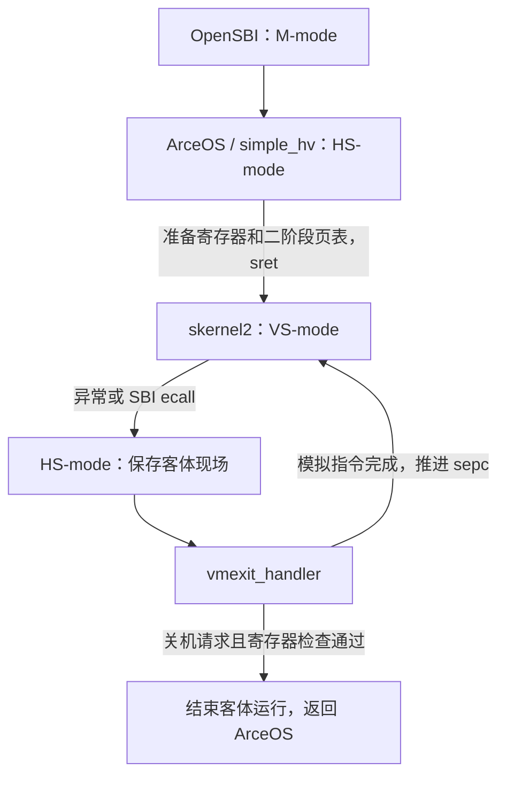

# 第六题：运行客体内核并处理虚拟机退出

本题让 [simple_hv](../arceos/exercises/simple_hv/src/main.rs) 运行一个独立的 RISC-V 客体程序 [skernel2](../arceos/payload/skernel2/src/main.rs)。客体读取一个受保护的 CSR、读取一处未映射地址，再通过 SBI 请求关机；Hypervisor 需要接住这些退出事件，模拟前两条指令的执行结果，最后检查客体寄存器。

首次接触虚拟化时，可以先读[理解 Hypervisor：从虚拟机原理到 simple_hv](hypervisor.md)，了解宿主、客体、vCPU、VM Exit 和两阶段地址转换，再结合本文阅读具体实现。

本次实现保留客体代码和课程测试脚本，修改 Hypervisor 的退出处理、现场切换保护、二阶段页表准备和镜像加载。最终的检查结果为：

```text
a0 = 0x6688, a1 = 0x1234
Shutdown vm normally!
Hypervisor ok!
```

## 1. 与第五题有什么不同

第五题的 `mapfile` 是用户程序，在 U-mode 运行，通过系统调用向内核请求文件操作。第六题的 `skernel2` 是客体内核，在 VS-mode 运行，由 HS-mode 的 Hypervisor 提供执行环境。

| 项目 | 第五题 sys_map | 第六题 simple_hv |
| --- | --- | --- |
| 独立程序 | 用户程序 mapfile | 客体内核 skernel2 |
| 程序运行模式 | U-mode | VS-mode |
| 管理者运行模式 | S-mode | HS-mode |
| 进入管理者的典型原因 | 用户系统调用 | 非法指令、客体缺页、客体 SBI 调用 |
| 本题页表的主要用途 | 用户虚拟地址 → 物理地址 | 客体物理地址 → 宿主物理地址 |

HS-mode 是带 H 扩展的宿主 supervisor 模式，VS-mode 是客体 supervisor 模式。客体退出表示 CPU 从客体返回 Hypervisor 处理事件；退出后可以继续进入客体，并不一定表示关机。



## 2. 客体测例究竟做了什么

客体的入口只有四条汇编指令：

```asm
csrr a1, mhartid
ld   a0, 64(zero)
li   a7, 8
ecall
```

| 指令 | 含义 | 本题预期行为 |
| --- | --- | --- |
| `csrr a1, mhartid` | 读取硬件线程编号 CSR | 退出到 Hypervisor，由它向 a1 写入虚拟值 `0x1234` |
| `ld a0, 64(zero)` | 从地址 `0x40` 读取 8 字节 | 因二阶段映射不存在而退出，由 Hypervisor 向 a0 写入 `0x6688` |
| `li a7, 8` | 设置 legacy SBI 扩展编号 | 普通指令，由客体直接执行 |
| `ecall` | 发起 SBI 调用 | 退出到 Hypervisor，解析为 legacy shutdown |

`mhartid` 是机器级 CSR，VS-mode 不能直接读取它。这里的 `0x1234` 是题目约定的虚拟 hart 编号，不是读取宿主真实硬件后得到的编号。CSR 地址与访问权限可查阅 [RISC-V CSR 规范](https://docs.riscv.org/reference/isa/v20260120/priv/priv-csrs.html)。

同样，`0x6688` 是 Hypervisor 为本题约定的虚拟设备读取结果。地址 `0x40` 不对应本次分配的客体 RAM，不需要在宿主物理地址 `0x40` 写入这个值。

## 3. 客体文件怎样变成可执行内存

测试脚本先编译 payload，再通过 `update_disk.sh` 将 `payload/skernel2/skernel2` 放入 FAT 磁盘镜像的 `/sbin/`。该文件经过 `rust-objcopy -O binary`，是裸二进制镜像，不是交给本加载器解析的 ELF 文件。

[loader.rs](../arceos/exercises/simple_hv/src/loader.rs) 的处理过程为：

1. 打开 `/sbin/skernel2`，检查文件长度在 `1..=4096` 字节之间。
2. 用 `read_exact()` 将文件内容完整读入 4 KiB 内核缓冲区。
3. 在客体物理地址 `VM_ENTRY = 0x8020_0000` 分配一页清零内存。
4. 通过 `AddrSpace::write()` 将实际读取的文件内容写入底层物理页。
5. 将客体的初始 PC 设置为 `VM_ENTRY`。

```text
FAT 文件 /sbin/skernel2
    → 内核缓冲区
    → 分配的宿主物理页
    ← 二阶段页表中的 GPA 0x8020_0000
    ← 客体从这里取指
```

文件读取完成后，局部文件对象被释放；后续客体执行使用装载好的内存，不会每取一条指令就重新读取磁盘。

原加载器的缓冲区只有 64 字节，却在 `copy_nonoverlapping()` 中复制 4096 字节，会越界读取栈内存。本次改为页大小缓冲区，并且只写入文件实际长度；空文件、超过一页的文件和读取错误均返回错误。多页客体镜像与通用 ELF 装载不在本题实现范围内。

客体代码页的映射权限为 `READ | EXECUTE | USER`。G-stage 页表要求可访问的客体页设置 U 位；这里的 `USER` 不是说客体正在 VU-mode 运行。装载器通过内核直接映射写入物理页，因此无需给客体代码页增加写权限。

## 4. 两阶段地址转换在哪里

启用 H 扩展后，客体的地址转换可以分为：

```text
客体虚拟地址 GVA
    │ VS-stage，由 vsatp 控制
    ▼
客体物理地址 GPA
    │ G-stage，由 hgatp 控制
    ▼
宿主物理地址 HPA
```

本测例没有建立客体自己的页表，使用启动时的 `vsatp = Bare` 状态，所以第一阶段保持地址不变。客体从 `0x8020_0000` 取指时，这个数值也是 GPA；第二阶段才把它转换为实际分配的 HPA。

本次通过 `AddrSpace::new_empty()` 创建客体映射集合。`AddrSpace` 接口中名为虚拟地址的参数，在这里被用作 GPA。宿主运行 Rust 代码时仍使用自己的 `satp`；只把准备好的客体页表交给 `hgatp` 使用。

客体不需要宿主内核的高地址映射，因此没有沿用 `new_user_aspace()` 中复制宿主页表项的行为。

### 4.1 为什么额外分配 16 KiB 页表根

原代码直接把普通 Sv39 页表根写入 `hgatp`，但 `hgatp.MODE = 8` 表示 Sv39x4，它要求根表有 2048 个条目，占 16 KiB，并按 16 KiB 对齐。

本次使用：

```rust
#[repr(C, align(16384))]
struct GuestPageTableRoot([u64; 2048]);
```

将其放在 `Box` 中，复制普通 Sv39 根表的前 512 项，并保持另外 1536 项为零。当前客体地址范围位于低地址部分，可以复用这些根表项指向的下级页表。加载完成后才制作此根表，运行期间不再增删客体映射。

`hgatp` 的设置为：

```rust
let hgatp = (8usize << 60) | (root_paddr.as_usize() >> 12);
```

写入后执行 `hfence.gvma`，同步 G-stage 地址转换。根表及 `AddrSpace` 都保留到客体运行结束；退出后先清空 `hgatp` 并刷新，再释放存储。根表大小、对齐和 G-stage PTE 权限要求见 [RISC-V H 扩展规范](https://docs.riscv.org/reference/isa/v20260120/priv/hypervisor.html)。

## 5. 如何进入和退出客体

[prepare_guest_context()](../arceos/exercises/simple_hv/src/main.rs) 设置用于进入客体的现场：

| 状态 | 用途 |
| --- | --- |
| `hstatus.SPV = 1` | 通过 SRET 返回虚拟化执行环境 |
| `hstatus.SPVP = Supervisor` | 设定 HLV/HSV 等客体内存访问的有效特权级 |
| `sstatus.SPP = Supervisor` | 配合 SPV，使 SRET 进入 VS-mode |
| `guest_regs.sepc = VM_ENTRY` | 指定客体入口 PC |

[guest.S](../arceos/exercises/simple_hv/src/guest.S) 已提供 `_run_guest` 和 `_guest_exit`，本次复用它们：

1. `_run_guest` 保存宿主通用寄存器和部分 CSR。
2. 把 `stvec` 改为 `_guest_exit`，把客体上下文指针放入 `sscratch`。
3. 恢复客体通用寄存器、入口和返回状态，执行 `sret`。
4. 客体异常返回 HS-mode，CPU 跳到 `_guest_exit`。
5. 汇编通过 `sscratch` 找回上下文，保存客体寄存器和退出 PC。
6. 恢复宿主栈、寄存器和陷阱入口，返回 Rust 的 `run_guest()`。

Rust 随后保存 `scause`、`stval`、`htval` 和 `htinst`，交给退出处理逻辑。

### 5.1 为什么要保护中断状态

切换 `stvec`、`sscratch` 和栈指针需要多条指令。若在现场只切换了一半时进入普通宿主中断处理程序，它可能使用客体的零栈指针，或将上下文指针误认为普通陷阱栈。

本次在进入汇编前保存并关闭宿主的全局中断，同时保存 `sie` 并将它清零；初始客体返回现场也清除 HS `sstatus.SIE`，避免汇编加载该现场时提前开中断。客体退出、恢复宿主现场并完成退出处理后，再恢复 `sie` 和原来的全局中断状态。

两层保护各有作用：清除 SIE 保护 HS-mode 内的切换窗口；清空 `sie` 进一步屏蔽客体运行时可能送到 HS-mode 的中断。该选择适用于本题很短的单客体程序；运行长期客体时，需要实现宿主中断处理与虚拟中断注入，不能一直屏蔽中断。

## 6. 第一次退出：模拟 mhartid 读取

`csrr a1, mhartid` 的真实编码是：

```asm
csrrs a1, 0xf14, x0
```

它触发 `IllegalInstruction`。处理程序从客体代码页读出指令，检查除了目的寄存器 `rd` 外的所有位：

```rust
assert_eq!(inst & !0xf80, 0xf1402073);
let rd = GprIndex::from_raw((inst >> 7) & 0x1f).unwrap();
ctx.guest_regs.gprs.set_reg(rd, VM_HART_ID);
ctx.guest_regs.sepc += 4;
```

`0xf80` 对应指令的 `[11:7]`，也就是 `rd` 字段。这样只接受 `CSRRS rd, mhartid, x0`，其他 CSR 和写 CSR 的指令不会被当成合法读取处理。寄存器编号从指令中解析，不依赖固定写入 a1；如果目标为 x0，已有 `set_reg()` 会保持零寄存器语义。

这里的 `guest_instruction()` 使用 `AddrSpace::read()`，经 GPA → HPA 查询后从内核直接映射读取指令，没有将客体 PC 直接转换为宿主可解引用的指针。这依赖本测例 GVA = GPA 的条件。

## 7. 第二次退出：模拟地址 0x40 的读取

`ld a0, 64(zero)` 的有效地址为：

```text
x0 + 64 = 0 + 0x40 = 0x40
```

G-stage 页表中只建立了客体代码页映射，没有 GPA `0x40` 的映射，因此触发 `LoadGuestPageFault`。

处理程序首先还原故障 GPA：

```rust
let fault_addr = (ctx.trap_csrs.htval << 2)
    | (ctx.trap_csrs.stval & 0x3);
```

在课程 QEMU 的这个直接读取异常中，`htval` 提供右移两位后的 GPA，`stval` 提供故障 GVA。这里应得到 `0x40`。规范允许部分实现不提供非零 `htval`，而客体页表隐式访问也有不同的解释规则；本题只处理当前 Bare 模式下的显式读取，详见 [H 扩展的 Guest-Page Faults 与 htval](https://docs.riscv.org/reference/isa/v20260120/priv/hypervisor.html)。

确认地址后，再检查指令必须为 `ld rd, 64(x0)`，解析 `rd`，写入 `VM_MMIO_VALUE = 0x6688`，将客体 PC 推进 4 字节。

该分支没有给地址 `0x40` 新增 RAM 映射。它直接模拟一次虚拟 MMIO 读取的效果，再让客体执行下一条指令。任意其他地址或加载宽度都会被拒绝，避免把真实错误也变成一次成功读取。

## 8. 为什么两次处理都要推进 sepc

异常发生时，这两条指令都没有正常完成，保存的 `sepc` 仍然指向引发异常的那条指令。模拟完成以后，如果不改变 PC，重新进入客体就会重复执行它，再次触发同样的退出。

本题模拟的两条指令均为 32 位，所以执行 `sepc += 4`。课程工具链对原客体的反汇编结果为：

| 客体运行地址 | 指令 | 长度 |
| --- | --- | --- |
| `0x8020_0000` | `csrr a1, mhartid` | 4 字节 |
| `0x8020_0004` | `ld a0, 0x40(zero)` | 4 字节 |
| `0x8020_0008` | `li a7, 8` | 2 字节，使用压缩编码 |
| `0x8020_000a` | `ecall` | 4 字节 |

`li` 由硬件正常执行，PC 自然前进 2 字节；`ecall` 被识别为关机后不再恢复客体，所以无须为继续执行调整 PC。不能把所有 RISC-V 指令都当作 4 字节。

若采用另一种缺页处理方式：建立映射后重试原加载指令，就应保留原 PC。当前实现已经替客体完成了读取，所以需要跳到下一条。

## 9. 第三次退出：SBI 关机与结果检查

VS-mode 的 `ecall` 产生 `VirtualSupervisorEnvCall`。已有 [SBI 消息解析器](../arceos/exercises/simple_hv/src/sbi/mod.rs) 将 a7 中的 legacy 编号 `8` 转换为 `SbiMessage::Reset(...)`。

在关机分支，Hypervisor 检查：

```rust
assert_eq!(a0, 0x6688);
assert_eq!(a1, 0x1234);
```

这两个断言把前两次模拟与最后一次退出连起来：既要设置正确寄存器，也要在恢复和再次退出时保留这些值。通过检查后才输出 `Shutdown vm normally!` 并返回 `true`，结束运行循环。

此处关闭的是客体的执行流程，没有把客体关机请求直接转发给宿主 OpenSBI。宿主随后解除 G-stage 页表、输出 `Hypervisor ok!`，从 `main()` 正常返回，由 ArceOS 的退出流程结束 QEMU；原来的成功路径 `panic!("Hypervisor ok!")` 已改为普通输出。

## 10. 文件分工与实现范围

| 文件 | 作用及本次修改 |
| --- | --- |
| [simple_hv/main.rs](../arceos/exercises/simple_hv/src/main.rs) | 准备客体、设置二阶段页表、保护中断状态、模拟退出并完成正常结束 |
| [simple_hv/loader.rs](../arceos/exercises/simple_hv/src/loader.rs) | 装载一页以内的裸镜像，修复越界读取并检查文件长度 |
| [simple_hv/vcpu.rs](../arceos/exercises/simple_hv/src/vcpu.rs) | 已有的宿主和客体现场结构，以及汇编字段偏移定义 |
| [simple_hv/guest.S](../arceos/exercises/simple_hv/src/guest.S) | 已有的实际进入和退出汇编 |
| [simple_hv/regs.rs](../arceos/exercises/simple_hv/src/regs.rs) | 已有的寄存器编号与访问方法 |
| [skernel2/main.rs](../arceos/payload/skernel2/src/main.rs) | 课程客体测例，保持原样 |
| [test-simple_hv.sh](../scripts/test-simple_hv.sh) | 课程评测脚本，保持原样 |

练习使用自己目录下的 vCPU、CSR 和 SBI 代码，没有改动 `modules/riscv_vcpu`。目前支持本题的单客体、Bare 第一阶段、固定形式的两条模拟指令和关机检查；尚不支持通用指令模拟、客体分页、多 vCPU、虚拟设备总线或长期客体的中断调度。

## 11. 运行与验证

从仓库根目录进入课程环境：

```sh
./scripts/docker.sh
```

在容器内的仓库根目录运行：

```sh
./scripts/test-simple_hv.sh
```

脚本会重建生成的磁盘镜像、编译 payload、将客体装盘并启动 RISC-V QEMU。需要确认退出处理和断言通过，并在末尾看到：

```text
Emulate mhartid: A1 = 0x1234
Emulate MMIO read: [0x40] = 0x6688
VmExit Reason: VSuperEcall: Some(Reset(Reset { reset_type: Shutdown, reason: NoReason }))
a0 = 0x6688, a1 = 0x1234
Shutdown vm normally!
Hypervisor ok!
simple_hv pass
```

若只想利用已准备好的磁盘镜像快速运行，可在容器的 `arceos/` 目录执行：

```sh
make run A=exercises/simple_hv BLK=y QEMU_LOG=n
```

这条命令不会重新编译并装入 payload；修改客体后应重新运行完整脚本。`QEMU_LOG=n` 关闭指令跟踪，便于快速观察控制台；课程脚本仍使用其原有配置。

本次已在课程 Docker 环境中通过原版 `test-simple_hv.sh`，并使用临时客体和磁盘副本验证以下分支，没有修改课程 payload 源码或评测脚本：

| 补充验证 | 实际结果 |
| --- | --- |
| 用 t0、t1 接收模拟结果，随后再搬到 a1、a0；同时执行目的为 x0 的两种读取 | 正确关机，两个检查值保持正确 |
| 读取未支持的 `mscratch` CSR | 报告 `Unsupported CSR instruction`，不输出关机成功标记 |
| 读取 GPA `0x48` | 报告 `Unexpected guest physical address` |
| 对地址 `0x40` 使用 `lw`，而不是 `ld` | 报告 `Unsupported MMIO load` |
| 空镜像或 4097 字节镜像 | 装载阶段返回 `InvalidInput` |

修改过的 Rust 文件通过 `rustfmt --check`，改动通过 `git diff --check`。
