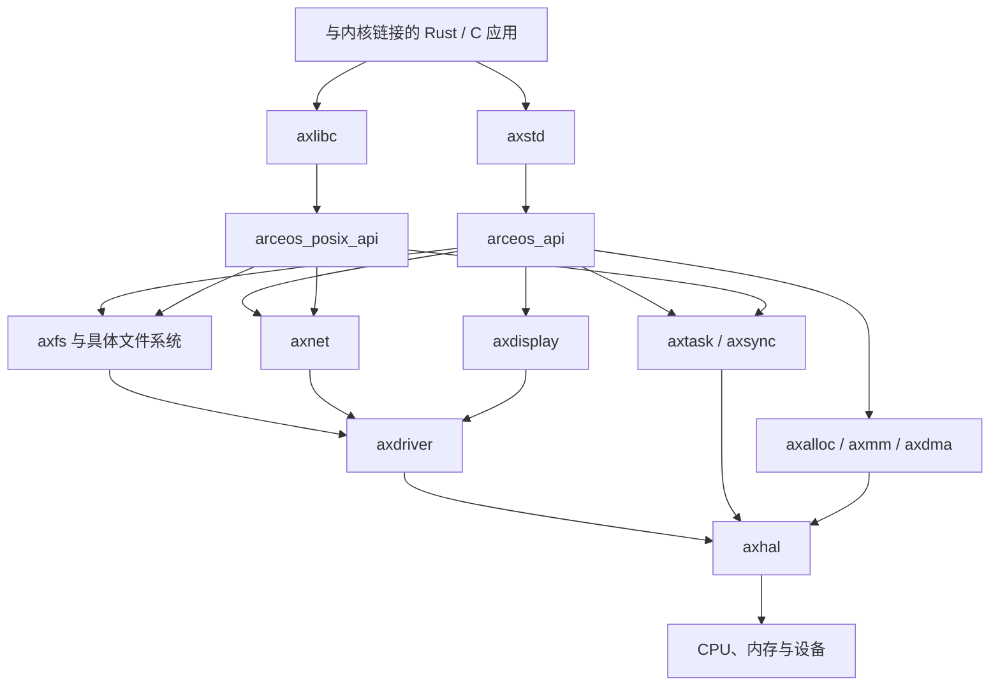

# ArceOS 项目架构与模块实现导读

本文面向刚开始阅读操作系统源码的读者，依据本仓库当前的 `arceos/` 代码编写。重点说明各层负责什么、核心数据保存在哪里，以及一次操作如何从应用传到底层。

本仓库包含 ArceOS 基础组件、课程示例和练习。文中将“已有实现”和“练习预期实现”分开说明；目录中存在某个模块，并不表示它一定被当前应用编译或已经实现全部功能。

## 1. 整体设计：按应用需要组合操作系统

ArceOS 是用 Rust 编写的组件化操作系统。它的基础用法是构建 **unikernel**：把应用与它需要的操作系统组件链接成一个可启动镜像，应用直接调用内核服务。

例如，一个只打印文字的程序不需要文件系统和网络；HTTP 服务需要内存分配、网卡驱动和协议栈；文件操作程序需要文件系统及其相关组件。这些功能主要通过 Cargo features 在编译时选择。

在基础 unikernel 模式下，`axstd` 的函数通过普通函数调用进入内核组件，不必先执行用户态系统调用。本仓库的 `tour/m_*`、`exercises/sys_map` 等示例进一步组合地址空间、用户态上下文和陷阱处理，演示运行独立用户程序；`tour/h_*` 则演示虚拟化。

因此，阅读时要区分三种执行对象：

| 对象 | 从哪里开始执行 | 如何请求底层服务 |
| --- | --- | --- |
| 与内核一起链接的应用 | `axruntime` 调用应用 `main()` | 直接调用 `axstd`、API 或内核模块 |
| 用户态程序 | 示例装载 ELF 后进入用户态入口 | 通过陷阱进入示例注册的系统调用处理函数 |
| 客体内核 | 虚拟机监控程序设置客体入口后进入客体 | 执行 SBI 调用等操作，必要时退出到宿主处理 |

## 2. 目录结构

以下路径以 `arceos/` 为根：

```text
arceos/
├── Cargo.toml               工作区成员、公共依赖和依赖替换
├── Makefile                 构建入口，选择应用、架构和运行参数
├── api/
│   ├── axfeat/              汇总与转发功能开关
│   ├── arceos_api/          面向 Rust 的统一内核接口
│   └── arceos_posix_api/    POSIX 风格接口和文件描述符管理
├── ulib/
│   ├── axstd/               类似 Rust std 的应用库
│   └── axlibc/              面向 C 应用的库与 C ABI 接口
├── modules/                 内核组件：启动、内存、任务、驱动、文件系统等
├── axfs_ramfs/              本地 RAMFS 实现，包含文件重命名逻辑
├── platforms/               各硬件平台的 TOML 配置
├── scripts/                 Cargo、链接、QEMU 等构建运行脚本
├── examples/                hello world、shell、HTTP 等示例
├── tour/                    课程中的 unikernel、用户态与虚拟化示例
├── exercises/               六项课程练习
├── payload/                 被装载的用户程序、客体内核及其构建文件
├── tools/                   依赖分析、测试辅助和板级工具
└── doc/                     架构与构建文档
```

仓库根目录还有 `scripts/`、`docs/`、`course/` 等教学与评测资料，不要与 `arceos/scripts/` 混淆。根目录的 `crates/kernel_guard/` 是一个本地基础组件，工作区通过 `[patch.crates-io]` 使用它。

**`modules/` 与基础 crates 的区别：** 前者负责组织操作系统行为，例如“如何调度任务”；后者通常提供可复用的机制，例如调度算法、页表操作、锁、地址类型。许多基础 crates 由 Cargo 从注册表或 Git 依赖获取，并不都在本地 `crates/` 目录中。

## 3. 架构分层与主要依赖



这是主要服务调用关系，省略了日志、配置以及部分交叉依赖。应用也可以直接依赖内核模块，课程示例经常这样做。

另外有三个贯穿各层的组件：

- `axruntime`：负责把已选中的组件初始化，并进入应用。
- `axconfig`：提供构建时生成的平台常量。
- `axlog`：提供日志和格式化输出。

这些层次是职责划分，并不意味着 Cargo 依赖只能严格向下一层。例如 `axhal` 的页表适配代码也依赖 `axalloc` 分配页表页。

## 4. 功能选择与构建过程

### 4.1 功能开关怎样传到模块

以 Rust 应用启用文件系统为例，主要关系是：

```text
应用依赖 axstd，并开启 fs
    ├── arceos_api/fs：暴露文件接口
    └── axfeat/fs
        ├── alloc：内存分配
        ├── paging：页表与地址空间
        ├── axdriver/virtio-blk：块设备驱动
        ├── axfs：文件系统组件
        └── axruntime/fs：启动时初始化文件系统
```

`axfeat` 本身主要承担功能装配，不实现文件读写算法。`axstd` 一方面开放应用接口，另一方面把功能开关转发给 `axfeat` 和 `arceos_api`。

常用开关及其作用：

| feature | 主要效果 |
| --- | --- |
| `alloc` | 初始化常规全局分配器，使 `Vec`、`String`、`Arc` 等能够分配内存 |
| `paging` | 启用页表操作，初始化 `axmm` 的内核地址空间；同时引入 `alloc` |
| `multitask` | 启用任务管理和可阻塞的同步机制；同时引入 `alloc` |
| `sched_rr` / `sched_cfs` | 选择调度算法，并启用所需的抢占与中断功能 |
| `fs` / `net` / `display` | 引入对应子系统、默认设备驱动及启动初始化 |
| `smp` | 启用多核相关代码 |
| `myfs` | 由应用提供主文件系统的创建接口 |
| `alt_alloc` | 接入课程中的替代分配器 |

这里的依赖关系应以 [axfeat/Cargo.toml](../arceos/api/axfeat/Cargo.toml) 为准。功能组合也受当前代码约束：例如 `axruntime` 分别为 `alloc` 和 `alt_alloc` 定义了同名初始化函数，不能把它们随意同时开启。

### 4.2 从 Make 到启动镜像

1. `Makefile` 读取 `A`、`ARCH`、`PLATFORM`、`SMP` 等参数，确定应用、目标架构和平台。
2. `scripts/make/features.mk` 把功能参数转换成 Cargo features；构建脚本还会设置 `AX_PLATFORM`、`AX_SMP`、`AX_LOG` 等环境变量。
3. `axconfig/build.rs` 根据平台 TOML 和默认配置生成 Rust 常量；`axhal/build.rs` 处理平台相关构建与链接脚本。
4. Cargo 编译应用及所需组件，链接得到 ELF；`rust-objcopy` 再生成裸二进制。
5. `run` 目标调用 QEMU，按配置提供 CPU、磁盘、网络等硬件。

例如在 `arceos/` 目录构建最小课程应用：

```sh
make A=tour/u_1_0 ARCH=riscv64 build
```

`FEATURES=fs` 决定把文件系统代码编译进镜像，`BLK=y` 决定给 QEMU 配置块设备，两者职责不同。网络和显示同样需要同时考虑代码功能与运行时设备配置。

## 5. 启动流程：从 CPU 入口到应用 main

以下以本课程主要使用的 RISC-V QEMU virt 平台为例：

```text
固件把控制权交给内核入口
  → axhal::_start
  → 设置启动栈，建立早期 Sv39 页表，启用 MMU
  → 转入高地址的 rust_entry
  → 清零 BSS，初始化当前 CPU、陷阱入口和早期时钟
  → axruntime::rust_main
  → 日志 → 分配器 → 内核地址空间 → 平台设备
  → 调度器 → 设备探测 → 文件系统 / 网络 / 显示
  → 启动其他 CPU → 注册中断处理 → 按配置初始化 TLS
  → 等待各 CPU 初始化完成
  → 应用 main()
  → 任务退出或终止系统
```

图中许多步骤由 feature 控制。例如未开启 `multitask` 就不初始化调度器，未开启 `fs` 就不初始化文件系统。

两个页表阶段也不同：`axhal` 建立早期页表，让启动代码能够运行；开启 `paging` 后，`axmm` 再按内存区域及属性建立内核页表。

源码入口：

- [RISC-V 启动汇编](../arceos/modules/axhal/src/platform/riscv64_qemu_virt/boot.rs)
- [平台 rust_entry](../arceos/modules/axhal/src/platform/riscv64_qemu_virt/mod.rs)
- [运行时 rust_main](../arceos/modules/axruntime/src/lib.rs)
- [多核初始化](../arceos/modules/axruntime/src/mp.rs)

## 6. 基础模块的实现逻辑

### 6.1 axconfig：把平台参数变成常量

`axconfig` 保存物理内存范围、内核地址空间范围、物理与虚拟地址偏移、MMIO 区域、任务栈大小等参数。

基本过程是：`build.rs` 选择平台 TOML，用 `defconfig.toml` 补齐缺省项，再把配置项转成 `OUT_DIR/config.rs` 中的 Rust 常量。其他模块引用 `axconfig::TASK_STACK_SIZE` 等常量，无需各自解析配置文件。

入口：[axconfig/build.rs](../arceos/modules/axconfig/build.rs)、[默认配置](../arceos/modules/axconfig/defconfig.toml)。

### 6.2 axhal：隔离架构和硬件平台差异

`axhal` 是硬件抽象层。它主要分成两部分：

- `arch/`：与指令集有关的寄存器操作、任务上下文、陷阱现场、切换与返回代码。
- `platform/`：与具体机器有关的启动、串口、时钟、中断控制器、内存布局和多核启动代码。

上层调用 `axhal::console`、`time`、`irq`、`mem` 等统一接口，平台选择代码再把操作转发到具体实现。例如输出字节最终进入平台串口或固件接口；任务切换最终进入架构相关的上下文切换代码。

`paging.rs` 对接通用页表 crate，并提供分配、释放页表页的适配器。RISC-V 使用 Sv39 页表类型。

入口：[axhal/lib.rs](../arceos/modules/axhal/src/lib.rs)、[架构目录](../arceos/modules/axhal/src/arch)、[平台目录](../arceos/modules/axhal/src/platform)。

### 6.3 axruntime：组织初始化顺序

`axruntime` 负责从“硬件已能执行 Rust”推进到“应用可以使用内核服务”。它遍历内存区域，初始化分配器和地址空间，再初始化调度、驱动及各子系统，最终调用应用导出的 `main`。

它还为 `axlog::LogIf` 提供控制台、时间、CPU ID 和任务 ID 的实现，并在启用中断时注册定时器处理函数。定时器中断会设置下一次触发时间，并在多任务配置下调用 `axtask::on_timer_tick()`。

入口：[axruntime/lib.rs](../arceos/modules/axruntime/src/lib.rs)。

### 6.4 axlog：统一日志与控制台格式化输出

`axlog` 对接 `log` crate，提供 `error!`、`warn!`、`info!`、`debug!`、`trace!`，根据日志等级格式化颜色、时间与来源信息，再写入控制台。

在裸机环境中，它通过 `LogIf` 接口取得实际输出能力，因此不必直接依赖某个平台的串口实现。格式化输出路径使用锁防止并发输出交错。`ax_println!` 是控制台打印接口，不等同于受日志等级过滤的 `info!`。

入口：[axlog/lib.rs](../arceos/modules/axlog/src/lib.rs)。

## 7. 内存模块的实现逻辑

### 7.1 axalloc：分配内存块和连续页

`axalloc` 的 `GlobalAllocator` 同时管理字节分配器和页分配器：

```text
Vec / String / Box 等申请内存
  → GlobalAlloc::alloc(Layout)
  → 字节分配器
      └── 空间不足时，从页分配器取得连续页，扩充字节堆
```

页分配器使用位图管理页；字节分配算法由 feature 选择，支持 TLSF、slab、buddy，当前 Cargo 默认配置选择 TLSF。初始化时先把主要内存区域交给页分配器，再取出 32 KiB 初始化字节堆。

分配器通过 `#[global_allocator]` 注册，使 Rust 的 `alloc` 容器能够使用它。锁保护分配器内部状态。`axalloc` 解决“哪块内存可用”，并不负责为每个进程设计虚拟地址空间。

入口：[axalloc/lib.rs](../arceos/modules/axalloc/src/lib.rs)。

### 7.2 axmm：管理虚拟地址空间与映射

核心类型 `AddrSpace` 包含三部分：

```rust
va_range: VirtAddrRange,     // 这个地址空间管理的虚拟地址范围
areas: MemorySet<Backend>,  // 已登记的内存区域及映射策略
pt: PageTable,              // 实际供硬件查询的页表
```

它提供创建地址空间、寻找空闲范围、建立映射、解除映射、修改权限、访问地址空间数据和处理缺页等操作。内核初始化时遍历硬件内存区域，建立线性映射。

两种主要映射后端是：

- `Linear`：虚拟地址与物理地址相差固定偏移，适合映射已存在的物理内存。
- `Alloc`：为区域分配物理页；`populate=true` 时预先分配，`false` 时留待访问触发缺页后再分配。

创建用户地址空间时，代码建立低地址范围，并复制内核部分的页表映射；复制映射不等于复制一份内核数据。具体示例还需要注册缺页处理函数，才能把陷阱接到 `AddrSpace::handle_page_fault`。

入口：[axmm/lib.rs](../arceos/modules/axmm/src/lib.rs)、[aspace.rs](../arceos/modules/axmm/src/aspace.rs)、[映射后端](../arceos/modules/axmm/src/backend)。

### 7.3 axdma：为设备准备 DMA 内存

设备访问内存时使用的地址可能与 CPU 虚拟地址不同。`axdma` 返回 `DMAInfo`，其中同时保存 CPU 可访问的指针和设备使用的总线地址。

实现会根据申请大小使用字节分配或连续页分配，并通过 `axmm` 调整相应页的映射属性为不可缓存；总线地址根据物理地址和平台配置的偏移计算。因此它同时依赖分配器、地址转换与页表管理。

入口：[axdma/lib.rs](../arceos/modules/axdma/src/lib.rs)、[dma.rs](../arceos/modules/axdma/src/dma.rs)。

### 7.4 alt_axalloc 与 bump_allocator：替代分配器练习

`alt_axalloc` 保留与全局分配器相近的接口，把请求交给锁保护的 `EarlyAllocator`。后者位于 `modules/bump_allocator/`。

`EarlyAllocator` 从内存两端分配：字节块从低地址向上增长，页从高地址向下增长；字节分配计数降到零时整体回收字节区域，页区域不回收。分配时检查对齐、空间边界与地址运算溢出。

**当前实现状态：** 已实现初始化、双端分配、字节整体回收与统计，外层追加内存接口也已接通。它只支持一段连续区域及满足条件的连续扩展，不支持任意不连续的多区域分配。5 项单元测试和课程 `alt_alloc` QEMU 测例均已通过，详见[第三题解题文档](03-alt-alloc.md)。

入口：[alt_axalloc/lib.rs](../arceos/modules/alt_axalloc/src/lib.rs)、[bump_allocator/lib.rs](../arceos/modules/bump_allocator/src/lib.rs)。

## 8. 任务与同步模块的实现逻辑

### 8.1 axtask：任务状态、队列与上下文切换

`TaskInner` 保存任务 ID、名称、入口、状态、内核栈、CPU 上下文、退出码和等待退出的队列等信息。`AxTaskRef` 使用 `Arc` 共享任务所有权。

任务主要在以下状态之间变化：

```text
Ready ──被选中──→ Running ──主动让出或被抢占──→ Ready
                    │
                    ├──等待事件──→ Blocked ──被唤醒──→ Ready
                    └──退出────→ Exited
```

基本调度过程：

1. 创建任务，分配内核栈，初始化 CPU 上下文，放入运行队列。
2. `yield_now`、阻塞、退出或抢占触发重新调度。
3. 调度器选择下一个任务；没有就绪任务时运行 idle 任务。
4. 更新任务状态和当前任务引用，调用 `axhal` 的上下文切换实现。
5. 已退出任务交给回收任务，在引用条件允许时释放资源。

调度算法来自 `scheduler` 依赖，默认回退到 FIFO，也可以选择 RR 或 CFS。当前实现使用一个全局运行队列，各 CPU 保存自己的当前任务和 idle 任务信息。

`WaitQueue` 组织阻塞和唤醒；定时器事件用于睡眠到期唤醒。未启用多任务时，模块只提供简化接口，睡眠采用忙等，`yield_now` 不进行任务切换。

入口：[task.rs](../arceos/modules/axtask/src/task.rs)、[run_queue.rs](../arceos/modules/axtask/src/run_queue.rs)、[api.rs](../arceos/modules/axtask/src/api.rs)、[wait_queue.rs](../arceos/modules/axtask/src/wait_queue.rs)。

### 8.2 axsync：根据任务环境选择锁

启用 `multitask` 时，`Mutex` 使用原子变量记录持有者，并用 `UnsafeCell` 保存受保护数据。竞争失败的任务进入 `WaitQueue`，释放锁时唤醒一个等待者，等待者重新竞争锁。

`MutexGuard` 提供对数据的访问，离开作用域时通过 `Drop` 自动解锁。未开启 `multitask` 时，`Mutex` 是 `kspin::SpinNoIrq` 的别名。模块也重新导出自旋锁供内核临界区使用。

RAMFS 中的 `spin::RwLock` 则来自另一个锁 crate：读锁允许并行读取，写锁用于独占修改。因此即使方法接收 `&self`，也能通过写锁修改内部内容。

入口：[axsync/lib.rs](../arceos/modules/axsync/src/lib.rs)、[mutex.rs](../arceos/modules/axsync/src/mutex.rs)。

### 8.3 kernel_guard：保护内核临界区

这个本地基础 crate 位于仓库根目录的 `crates/kernel_guard/`。它提供关闭本 CPU 中断、禁止抢占等 RAII guard，离开作用域时恢复相应状态，供内核锁等机制使用。

抢占控制通过 `KernelGuardIf` 接口接入 `axtask`。禁止本 CPU 中断并不能单独防止其他 CPU 同时访问共享数据，多核互斥仍需要锁的配合。

入口：[kernel_guard/lib.rs](../crates/kernel_guard/src/lib.rs)。

## 9. 驱动、网络与显示模块的实现逻辑

### 9.1 axdriver：探测设备，交给上层子系统

`axdriver` 组织底层驱动，而具体驱动能力大量来自 `axdriver_*` 依赖。它定义统一的设备类型，并把探测结果按网络、块设备、显示设备归入 `AllDevices`。

```text
init_drivers()
  → 探测全局设备和 PCI / MMIO 总线设备
  → 创建具体驱动实例
  → 放入 AllDevices 的分类容器
  → axruntime 把各类容器交给 axfs / axnet / axdisplay
```

设备模型可在编译时选择：静态模式使用具体类型，动态模式使用 trait 对象并支持更灵活的多实例容器。VirtIO 适配层提供地址转换、页分配等硬件接口。

当前 MMIO 探测遍历 `axconfig::VIRTIO_MMIO_REGIONS` 中配置的区域，源码仍把解析设备树标为 TODO；不能仅根据模块注释推断它已动态解析 DTB。

入口：[axdriver/lib.rs](../arceos/modules/axdriver/src/lib.rs)、[bus/](../arceos/modules/axdriver/src/bus)、[virtio.rs](../arceos/modules/axdriver/src/virtio.rs)。

### 9.2 axnet：把网卡连接到 smoltcp

初始化时，`axnet` 取出一个网卡设备，创建 smoltcp 网络接口、套接字集合和监听表，设置 IP、网关等参数，再向上提供 TCP、UDP、DNS 接口。

它通过适配器把驱动的接收与发送缓冲区转换成 smoltcp 的 `RxToken`、`TxToken`。TCP/UDP 对象用句柄访问共享套接字集合；`poll_interfaces()` 轮询设备并推进协议栈，处理报文与连接状态。

当前主要靠轮询推进网络处理，不能把它理解为已经具有完整的中断驱动异步网络机制。

入口：[axnet/lib.rs](../arceos/modules/axnet/src/lib.rs)、[smoltcp_impl/mod.rs](../arceos/modules/axnet/src/smoltcp_impl/mod.rs)、[tcp.rs](../arceos/modules/axnet/src/smoltcp_impl/tcp.rs)、[udp.rs](../arceos/modules/axnet/src/smoltcp_impl/udp.rs)。

### 9.3 axdisplay：提供帧缓冲区访问

`axdisplay` 取出一个显示设备，用 `LazyInit<Mutex<AxDisplayDevice>>` 保存。上层通过 `framebuffer_info()` 取得帧缓冲区信息，在对应内存中写入像素，再调用 `framebuffer_flush()` 请求驱动刷新。

当前模块主要封装帧缓冲区访问和刷新，图形窗口、控件与排版并不由它实现。

入口：[axdisplay/lib.rs](../arceos/modules/axdisplay/src/lib.rs)。

## 10. 文件系统：从路径到实际节点

### 10.1 axfs：组织路径、打开状态与挂载

`axfs` 的内部职责可以这样划分：

| 文件或目录 | 基本职责 |
| --- | --- |
| `api/` | 提供类似 `std::fs` 的文件、目录和路径操作 |
| `fops.rs` | 保存打开文件的节点、访问能力、读写偏移及追加模式；目录保存遍历位置 |
| `root.rs` | 选择路径起点、管理当前目录、匹配挂载点并转发操作 |
| `mounts.rs` | 创建 `/dev`、`/tmp`、`/proc`、`/sys` 等文件系统实例 |
| `dev.rs` | 把块设备包装成带位置的 `Disk`，适配字节流读写 |
| `fs/fatfs.rs` | 把 FAT 库的文件和目录包装为 VFS 节点 |
| `fs/myfs.rs` | 通过 `MyFileSystemIf` 调用应用提供的文件系统创建逻辑 |

默认功能下，主文件系统使用 FAT，`/tmp` 挂载 RAMFS，`/dev` 挂载设备文件系统。`/proc` 和 `/sys` 在当前实现中也是独立 RAMFS，预先写入少量兼容性目录和文件，并非完整、动态生成的 Linux procfs/sysfs。

`RootDirectory` 是统一挂载视图，保存 `main_fs` 和挂载点列表。`lookup_mounted_fs` 扫描列表，按最长匹配的挂载路径前缀选择文件系统，再把剩余路径交给它的根目录。

这里要区分三个概念：

| 概念 | 含义 | 示例类型 |
| --- | --- | --- |
| 文件系统实例 | 管理一棵文件树的对象 | `RamFileSystem`、`FatFileSystem` |
| 目录或文件节点 | 文件树中的一个对象 | `DirNode`、`FileNode` |
| 打开的文件对象 | 引用某个节点，另存读写位置和打开权限 | `axfs::fops::File` |

入口：[root.rs](../arceos/modules/axfs/src/root.rs)、[fops.rs](../arceos/modules/axfs/src/fops.rs)、[mounts.rs](../arceos/modules/axfs/src/mounts.rs)。

### 10.2 axfs_vfs：统一不同文件系统的操作接口

`axfs_vfs` 是依赖 crate，不在本仓库的 `modules/` 中。它为文件系统和节点定义统一接口：

- `VfsOps`：文件系统级操作，例如取得根目录、挂载和卸载。
- `VfsNodeOps`：节点级操作，例如查找、读写、创建、删除和重命名。
- `VfsNodeRef`：共享的节点 trait 对象引用，使上层能以相同方式操作不同节点实现。

调用 `node.rename(...)` 时，具体执行哪一份实现，由节点实际类型决定。RAMFS 目录会执行 `DirNode` 的实现，FAT 目录会执行它的目录包装实现。

### 10.3 axfs_ramfs：目录用映射表，文件用字节数组

本地 RAMFS 的主要数据结构是：

```text
RamFileSystem
  └── root: Arc<DirNode>
        ├── this: Weak<DirNode>                     自身弱引用
        ├── parent: RwLock<Weak<dyn VfsNodeOps>>     父目录弱引用
        └── children: RwLock<BTreeMap<String, VfsNodeRef>>
              ├── "a.txt" → FileNode
              │                └── content: RwLock<Vec<u8>>
              └── "sub"   → DirNode
```

文件名保存在父目录的 `children` 中；文件节点本身主要保存内容。强引用共享节点，父目录弱引用避免父子形成强引用环。

基本操作逻辑：

- **查找**：把路径拆成当前分量与剩余部分，处理 `.`、`..` 或查子节点表，再递归查找剩余路径。
- **创建**：先定位父目录，再按类型创建文件或目录节点，插入名称映射。
- **读取**：按偏移从 `Vec<u8>` 复制数据，最多读到文件末尾。
- **写入**：必要时扩展 `Vec<u8>` 并补零，再把数据复制到指定偏移。
- **截断**：缩短数组；扩长则补零。
- **删除**：从目录表移除名称；删除目录前检查它是否为空。

RAMFS 的内容位于内存中，不通过 FAT 或磁盘扇区保存，重启后不会由它自动持久化。

入口：[RAMFS lib.rs](../arceos/axfs_ramfs/src/lib.rs)、[dir.rs](../arceos/axfs_ramfs/src/dir.rs)、[file.rs](../arceos/axfs_ramfs/src/file.rs)。

### 10.4 rename 调用链与两层检查

对绝对路径调用 `std::fs::rename("/tmp/a", "/tmp/b")` 时，主要调用链为：

```text
axstd::fs::rename
  → arceos_api::fs::ax_rename
  → axfs::api::rename
  → axfs::root::rename
  → RootDirectory::rename
  → 解析源、目标所属文件系统和各自的剩余路径
  → src_fs.root_dir().rename(src_rel, dst_rel)
  → RAMFS DirNode::rename
```

**统一根目录层的检查：** 源和目标不能指向挂载根目录；两者必须属于同一个文件系统实例，通过 `Arc::ptr_eq` 判断。`src_fs` 是管理源文件的文件系统对象，不是源文件节点。

**路径细节：** 当前 `lookup_mounted_fs` 从挂载前缀之后直接取切片，因此 `/tmp/a` 的剩余路径实际可能是 `"/a"`。这里的路径已经去掉挂载前缀，RAMFS 随后会再移除开头的 `/`。

**RAMFS 目录层的检查与修改：**

1. 拆出源、目标父目录和文件名，拒绝空文件名、`.`、`..`。
2. 比较父目录字符串，当前实现仅允许同目录重命名普通文件。
3. 如果路径还含父目录，先找到该目录，再用纯文件名调用它的 `rename`。
4. 持有该目录子节点表的写锁，检查源存在且为普通文件。
5. 源、目标同名则成功；目标存在但不是普通文件则拒绝。
6. 移除旧键，将同一个节点引用插入新键；已有目标普通文件的映射会被替换。

例如 `"sub/a" → "sub/b"`，初次调用的 `self` 是 RAMFS 根目录，递归调用的 `self` 是 `sub`。最终修改 `sub.children`，而不是根目录的表。

重命名保留源节点及内容，因此已经打开的源文件仍引用同一个节点。当前父目录按字符串比较，没有在这里完整规范化路径；同一个文件系统内部的不同目录之间移动，也不在这份 RAMFS 实现的支持范围内。

## 11. API 与应用库的实现逻辑

### 11.1 arceos_api：统一 Rust 接口

`arceos_api` 按 `mem`、`task`、`fs`、`net`、`stdio` 等功能公开接口，在 `imp/` 中将调用转发给对应模块，并适配公开类型。

例如 `ax_rename` 调用 `axfs::api::rename`，任务创建接口交给 `axtask`。公开接口及类型通过宏按 feature 组织，使应用库不必直接依赖每个模块的内部结构。

入口：[arceos_api/lib.rs](../arceos/api/arceos_api/src/lib.rs)、[imp/](../arceos/api/arceos_api/src/imp)。

### 11.2 arceos_posix_api：POSIX 接口与文件描述符

该模块提供 `sys_open`、`sys_read`、`sys_write`、套接字、线程、管道和 I/O 多路复用等接口，具体能力受 feature 控制。

文件描述符路径的核心是共享表 `FD_TABLE`：用整数索引保存 `Arc<dyn FileLike>`，文件、控制台或套接字按统一接口提供读写与状态查询。读写时先用 fd 找对象，再调用对象方法；关闭时从表中移除引用。

这里的 `sys_*` 名称不意味着每次调用都会执行 CPU 的系统调用指令。直接链接的 C 应用可以经 `axlibc` 普通调用这些函数；用户态示例则可在自己的陷阱处理函数里转调它们。

入口：[arceos_posix_api/lib.rs](../arceos/api/arceos_posix_api/src/lib.rs)、[fd_ops.rs](../arceos/api/arceos_posix_api/src/imp/fd_ops.rs)。

### 11.3 axstd：让 Rust 应用使用熟悉的接口

`axstd` 在 `no_std` 环境下重新导出一部分 `core` 和 `alloc` 能力，并实现 `fs`、`thread`、`io`、`net`、`sync` 等接口。它们向下调用 `arceos_api`。

应用常使用 `extern crate axstd as std;`，于是源码能写 `std::fs::File` 或 `std::thread`。这些名称对应本项目的实现，不代表完整的宿主 Rust 标准库。

例如当前 `collections` 直接来自 `alloc::collections`，其中不包含 `HashMap`；课程的 `support_hashmap` 练习正需要补齐相应支持。

入口：[axstd/lib.rs](../arceos/ulib/axstd/src/lib.rs)。

### 11.4 axlibc：把 C 调用连接到内核服务

`axlibc` 提供 C ABI 函数及相关头文件、辅助实现。文件、网络、线程等操作主要连接到 `arceos_posix_api`，并处理 C 类型和错误返回约定。

典型路径是 `C read(fd, buf, len) → axlibc → arceos_posix_api → 文件或设备对象`。它提供所需的 libc 能力子集，不等同于完整的 Linux 用户环境。

入口：[axlibc/lib.rs](../arceos/ulib/axlibc/src/lib.rs)、[C 头文件](../arceos/ulib/axlibc/include)。

## 12. ELF、用户态与虚拟化扩展

### 12.1 elf：解析可执行文件格式

`modules/elf` 是本地 ELF 解析库，提供文件头、程序头、节、符号和重定位等结构的解析。`ElfBytes` 可在 `no_std` 环境处理字节切片。

解析器负责解释格式，实际分配地址空间、复制程序段和跳转入口的工作位于调用它的示例中。例如 `exercises/sys_map/src/loader.rs` 读取程序头、建立映射、装入文件数据并对剩余内存补零。

入口：[elf/lib.rs](../arceos/modules/elf/src/lib.rs)、[sys_map/loader.rs](../arceos/exercises/sys_map/src/loader.rs)。

### 12.2 用户态示例怎样组合基础模块

以 `exercises/sys_map` 的已有框架为例：

```text
创建用户 AddrSpace
  → 从文件系统读取 ELF，装入程序段
  → 映射用户栈，准备参数
  → 创建 axtask 任务，附加用户上下文和地址空间
  → 设置任务页表根，进入 UspaceContext::enter_uspace
  → 用户执行 ecall
  → axhal 保存 TrapFrame，分发 SYSCALL
  → 示例 syscall.rs 根据调用号执行处理
```

用户态的寄存器现场与内核任务切换现场用途不同：`TrapFrame` 用于保存陷阱发生时的状态，任务上下文用于调度切换；两者共同支撑用户程序执行。

当前 `sys_map` 已通过 `arceos_posix_api::sys_mmap` 实现立即分配的私有文件映射和匿名映射，具体分层与限制见[第五题说明](05-sys-map-syscall.md)。该示例仍不包含完整的进程管理系统。

入口：[sys_map/main.rs](../arceos/exercises/sys_map/src/main.rs)、[task.rs](../arceos/exercises/sys_map/src/task.rs)、[syscall.rs](../arceos/exercises/sys_map/src/syscall.rs)、[axhal/trap.rs](../arceos/modules/axhal/src/trap.rs)。

### 12.3 riscv_vcpu：保存客体状态并处理虚拟机退出

`riscv_vcpu` 依赖 RISC-V H 扩展，提供 `RISCVVCpu`、客体寄存器与 CSR 状态、SBI 消息解析，以及虚拟机退出原因。

基本过程是：检测或配置虚拟化能力，设置客体入口，配置 `hgatp` 二阶段页表，保存宿主状态并进入客体；客体退出后保存其现场，读取陷阱原因，处理 SBI、时钟或内存访问等事件，然后恢复运行或向上报告。

这里二阶段映射负责把客体物理地址转换为宿主物理地址，与普通用户程序的虚拟地址映射职责不同。当前模块仍有未覆盖事件的 `todo!()`，功能范围取决于示例。

`exercises/simple_hv` 还在自己的目录中保存了一套简化的 vCPU、CSR 和 SBI 代码，不能把它的所有行为归到 `modules/riscv_vcpu`。该练习加载客体 `skernel2`，模拟 `mhartid` 读取和地址 `0x40` 的读取，在 SBI 关机时验证寄存器，解除二阶段页表后正常返回。进入、退出与地址转换过程见[第六题说明](06-simple-hv.md)。

入口：[riscv_vcpu/lib.rs](../arceos/modules/riscv_vcpu/src/lib.rs)、[vcpu.rs](../arceos/modules/riscv_vcpu/src/vcpu.rs)、[simple_hv/main.rs](../arceos/exercises/simple_hv/src/main.rs)。

## 13. 用典型操作串起各模块

### 13.1 打印一行文字

```text
axstd::println!
  → axstd::io::__print_impl
      ├── 未启用 smp：标准输出锁 → 格式化 → arceos_api 字节输出
      │                                      → axhal 控制台
      └── 启用 smp：arceos_api 格式化输出 → axlog 的输出锁
                                             → LogIf → axhal 控制台
  → 平台输出实现
```

多核分支使用 `axlog` 的输出锁，以协调应用打印和内核日志；单核分支直接经标准输出的字节写入接口到达 `axhal`。

### 13.2 从 RAMFS 文件读取内容

```text
File::open("/tmp/a")
  → axstd / arceos_api / axfs
  → root 挂载解析，选中 /tmp 的 RAMFS
  → DirNode::lookup 找到 FileNode
  → 构建打开文件对象，保存节点引用与偏移

file.read(buf)
  → 检查打开对象的读权限
  → FileNode::read_at(offset, buf)
  → 从 content: Vec<u8> 复制内容
  → 更新打开对象的 offset
```

若文件位于 FAT 中，节点读写转入 FAT 包装层，再通过 `Disk` 和块设备驱动访问磁盘；RAMFS 路径直接访问内存中的内容。

### 13.3 创建并运行一个线程

```text
axstd::thread::spawn
  → arceos_api 任务接口
  → axtask 创建任务、内核栈和上下文
  → 加入运行队列
  → 调度器选中任务
  → axhal 上下文切换
  → 执行线程闭包
  → 退出并通知 join 等待者，随后回收资源
```

## 14. 六项练习与源码定位

| 练习 | 主要涉及的组件 | 理解实现时的重点 |
| --- | --- | --- |
| `print_with_color` | `axstd`、`arceos_api`、`axlog`、`axhal` | 跟踪打印路径，理解颜色控制字符如何到达终端 |
| `ramfs_rename` | `axfs`、`axfs_vfs`、本地 `axfs_ramfs` | 挂载解析与节点操作分层，移动目录表中的名称映射 |
| `alt_alloc` | `axfeat`、`axruntime`、`alt_axalloc`、`bump_allocator` | 接通 feature、初始化内存区域，实现替代分配算法 |
| `support_hashmap` | `axstd`、集合依赖、分配器 | 理解 `alloc::collections` 的能力范围，补充哈希集合支持 |
| `sys_map` | ELF 装载、`axmm`、系统调用、文件接口 | 把文件数据和用户映射结合，处理参数、地址与权限 |
| `simple_hv` | 练习内 vCPU 代码、`axmm`、客体 payload | 客体状态、二阶段映射、SBI 退出与返回流程 |

`ramfs_rename` 通过 `MyFileSystemIf` 创建自定义主文件系统；与此同时，`axfs` 默认还会把自己的 RAMFS 实例挂到 `/tmp`。练习操作 `/tmp/f1` 时应沿实际挂载关系定位后端，不能只看练习中创建主文件系统的代码。它的 `axfs_ramfs` 依赖声明与 `axfs` 使用的本地路径声明也不同，阅读依赖时要结合各自的 Cargo 配置。

## 15. 建议的源码阅读顺序

1. 从 [tour/u_1_0](../arceos/tour/u_1_0/src/main.rs) 看应用入口，确认它依赖哪些 feature。
2. 阅读 [axstd](../arceos/ulib/axstd/src/lib.rs) 与 [axfeat](../arceos/api/axfeat/Cargo.toml)，了解接口和组件怎样被选中。
3. 阅读 [axruntime](../arceos/modules/axruntime/src/lib.rs)，建立启动顺序，再按需追到 [axhal](../arceos/modules/axhal/src/lib.rs)。
4. 阅读 [axalloc](../arceos/modules/axalloc/src/lib.rs) 和 [axmm](../arceos/modules/axmm/src/lib.rs)，区分内存分配与地址映射。
5. 阅读 [axtask](../arceos/modules/axtask/src/run_queue.rs) 和 [axsync](../arceos/modules/axsync/src/mutex.rs)，理解任务状态与锁如何配合。
6. 沿文件创建、读取、重命名追到 [axfs/root.rs](../arceos/modules/axfs/src/root.rs) 和 [RAMFS dir.rs](../arceos/axfs_ramfs/src/dir.rs)。
7. 再根据目标阅读网络、用户态或虚拟化示例。

追踪每个函数时，可以依次确认：接收者 `self` 是什么类型、数据存在哪里、通过哪个 trait 调用、由谁持有锁、错误在哪一层返回。这样就能把模块名称对应到实际运行行为。
