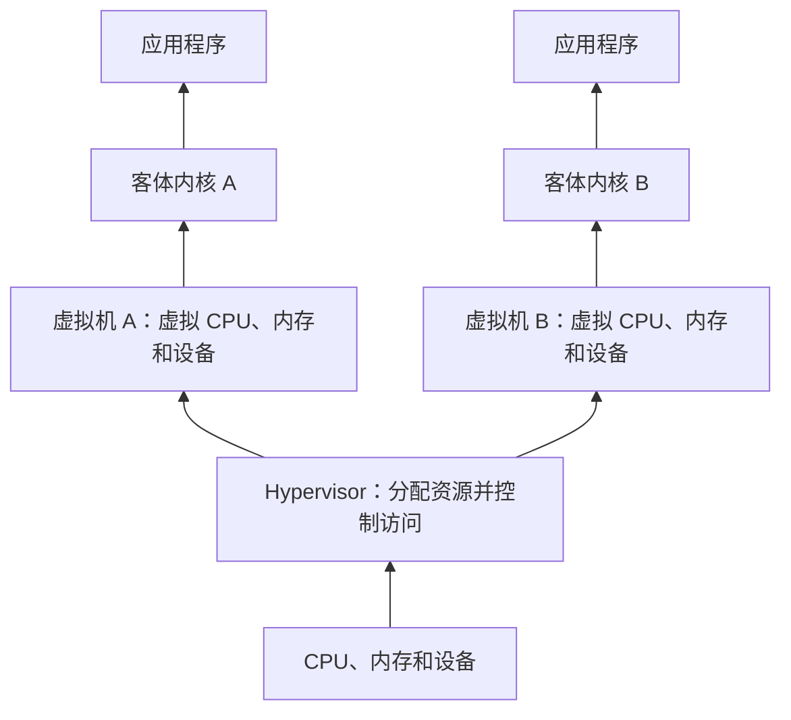

# 理解 Hypervisor：从虚拟机原理到 simple_hv

Hypervisor，中文通常叫“虚拟机监控器”，也称 Virtual Machine Monitor，简称 VMM。它负责建立和管理虚拟机，为客体提供 CPU、内存和设备的执行环境，并控制客体能够使用哪些宿主资源。

本仓库的 [simple_hv](../arceos/exercises/simple_hv/src/main.rs) 展示了一条完整但很小的运行路径：装载客体、准备 CPU 现场和内存映射、进入客体、处理退出事件，最后接收客体关机请求。本文先解释这些行为背后的概念，再对应到实验中的四条客体指令。具体改动和验证结果见[第六题实现说明](06-simple-hv.md)。

## 1. 为什么需要 Hypervisor

操作系统内核负责分配内存、设置页表、处理中断、管理设备。如果希望在一台机器上运行多个操作系统，就需要协调它们对底层资源的使用。

例如，两个操作系统都可能把地址 `0x80200000` 当作自己的内存，也都需要使用 CPU 和定时器。Hypervisor 为每个客体建立独立的资源视图，再把这些资源对应到宿主实际提供的 CPU、页面和设备接口。



虚拟机可以只有一个，也可以有多个。即使只运行一个客体，Hypervisor 仍然需要管理它的执行权限和资源边界；本题就是单客体情形。

Hypervisor 是一种软件职责。它可以与宿主内核组合，也可以和宿主系统中的其他组件协作。本实验使用 ArceOS 的内存管理、文件系统和运行时组件，另外加入管理客体的代码。

## 2. 宿主、客体、虚拟机和 vCPU

| 名称 | 含义 | 本实验中的对应对象 |
| --- | --- | --- |
| Host，宿主 | 提供并管理客体执行环境的一方 | ArceOS 与 simple_hv |
| Guest，客体 | 被放入虚拟环境运行的程序或系统 | skernel2 |
| VM，虚拟机 | 客体使用的 CPU 状态、内存、设备等资源组成的环境 | 本题建立的单客体环境 |
| vCPU，虚拟 CPU | 一个虚拟处理器的状态及其执行能力 | 以 VmCpuRegisters 为核心的客体 CPU 现场 |
| VM Entry | 将执行权交给客体 | 恢复客体现场并进入 VS-mode |
| VM Exit | 客体执行过程中返回 Hypervisor 处理事件 | 客体异常后进入退出处理路径 |

Host 和 Guest 的称呼取决于讨论的层次。本题讨论的是 ArceOS 管理 skernel2 的这一层；外面还有 QEMU 提供 RISC-V 机器环境，后文会单独说明。

## 3. CPU 怎样被虚拟化

### 3.1 普通指令怎样执行

在同架构且具备硬件虚拟化支持的环境中，客体可以直接使用处理器执行大量普通指令。例如：

```asm
add a0, a1, a2
```

这条指令只计算寄存器中的值。只要执行条件允许，处理器就可以完成它。已经具备有效地址映射和权限的普通加载、存储，也可以由硬件完成。

涉及受控制状态或资源的操作，需要遵循虚拟化规则。部分操作由硬件使用客体专属状态完成，部分操作会引起退出，交给 Hypervisor 处理。

例如，RISC-V 客体访问常规 supervisor CSR 时，硬件可以使用相应的 VS CSR；本题读取机器级 `mhartid` 则触发异常，最终交给 Hypervisor 模拟。这种区分避免了把每一次客体操作都变成软件处理。相关机制见 [RISC-V H 扩展规范](https://docs.riscv.org/reference/isa/priv/hypervisor.html)。

### 3.2 vCPU 怎样保存执行进度

一个可恢复执行的处理器现场需要描述寄存器、PC 和相关控制状态。客体暂停时，软件将需要保留的状态保存下来；再次运行时再恢复。

本题创建客体现场的代码是：

```rust
let mut ctx = VmCpuRegisters::default();
```

创建这个 Rust 结构体后，还需要执行汇编中的寄存器恢复和模式切换，CPU 才会开始运行客体。

当存在多个 vCPU 时，宿主可以将它们分时调度到同一物理 CPU，也可以让它们在不同物理 CPU 上并行运行。一个 vCPU 需要得到实际的 CPU 执行时间，才能向前执行。

[vcpu.rs](../arceos/exercises/simple_hv/src/vcpu.rs) 声明了宿主现场、客体现场和更多 CSR 状态结构。当前练习实际切换了哪些字段，需要结合 [guest.S](../arceos/exercises/simple_hv/src/guest.S) 阅读；仅声明一个保存字段，并不会自动使硬件完成保存和恢复。

### 3.3 VM Exit 之后还可以继续运行

一次退出可能是正常的管理事件，例如客体请求某项服务、访问模拟设备，或宿主需要处理某个事件。Hypervisor 根据原因决定后续动作。

| 情形 | 常见处理方式 |
| --- | --- |
| 可模拟的操作 | 更新客体状态，然后继续执行 |
| 需要补充内存映射 | 建立映射，再让客体重试访问 |
| 客体服务请求 | 完成请求，写回结果后恢复客体 |
| 客体关机请求 | 停止客体运行并处理资源生命周期 |
| 不支持或无法恢复的事件 | 报告错误，或按实现向客体交付相应异常 |

本题中，前两次退出都需要继续运行，第三次退出才结束客体：

```rust
while !run_guest(&mut ctx, &uspace) {}
```

真实系统也常提供“运行 vCPU，返回时获取退出原因”的接口。例如 Linux KVM 的 `KVM_RUN` 及其共享状态结构就提供了这一类能力。见 [KVM API 文档](https://docs.kernel.org/virt/kvm/api.html#the-kvm-run-structure)。

## 4. RISC-V 如何区分宿主与客体

在这个实验使用的 H 扩展环境中，可以按下表理解执行模式：

| 模式 | 角色 | 本实验中的代码 |
| --- | --- | --- |
| M-mode | 机器级固件 | OpenSBI |
| HS-mode | 带虚拟化管理能力的宿主 supervisor 模式 | ArceOS 与 simple_hv |
| VS-mode | 客体 supervisor 模式 | skernel2 |
| VU-mode | 客体系统中的用户模式 | 本题没有运行客体用户程序 |

HS-mode 管理 VS-mode 客体，M-mode 仍负责机器级职责。上述模式关系由 [RISC-V H 扩展](https://docs.riscv.org/reference/isa/priv/hypervisor.html)定义。

这可以和第五题对照：

| 观察点 | 第五题 sys_map | 第六题 simple_hv |
| --- | --- | --- |
| 加载的程序 | 用户程序 mapfile | 客体程序 skernel2 |
| 程序执行模式 | U-mode | VS-mode |
| 管理程序 | 内核的系统调用与异常处理代码 | 宿主中的 Hypervisor 代码 |
| 典型服务请求 | 用户程序向内核发起 syscall | 客体内核向其执行环境发起 SBI 调用 |

在完整的客体操作系统中，还可以同时存在两种请求路径：用户程序向客体内核发起系统调用，客体内核再根据需要请求 Hypervisor 提供服务。本题只演示了后者。

## 5. 内存虚拟化与两阶段地址转换

### 5.1 客体的物理地址由谁决定

客体操作系统通常也会维护页表，把程序虚拟地址转换为它所管理的物理地址。Hypervisor 还要决定这些客体物理地址对应哪些宿主页面。

因此需要区分三个地址：

| 缩写 | 全称 | 含义 |
| --- | --- | --- |
| GVA | Guest Virtual Address | 客体程序使用的虚拟地址 |
| GPA | Guest Physical Address | 客体系统使用的物理地址 |
| HPA | Host Physical Address | 在宿主机器中实际对应的物理地址 |


例如，可以建立下面这组假设映射：

```text
虚拟机 A：GPA 0x80200000 → HPA 0x84000000
虚拟机 B：GPA 0x80200000 → HPA 0x85000000
```

两个客体使用相同的 GPA，仍然能够访问各自独立的页面。客体可以改变自己管理的第一阶段映射，Hypervisor 通过第二阶段决定实际可访问的页面及权限。

### 5.2 vsatp、hgatp 和宿主 satp 的分工

在 RISC-V 中，`vsatp` 控制客体第一阶段地址转换，`hgatp` 控制 GPA 到 HPA 的第二阶段转换；宿主自身执行时还有自己的 `satp`。见 [H 扩展的两阶段地址转换说明](https://docs.riscv.org/reference/isa/priv/hypervisor)。

本题没有建立客体页表，使用启动时的 `vsatp = Bare` 状态，第一阶段保持地址不变。代码入口的转换过程是：

```text
客体从 0x80200000 取指
    → 第一阶段保持为 0x80200000
    → 第二阶段找到分配给代码的宿主物理页
    → 从该页读取指令
```

本题用 `AddrSpace` 表示客体的 GPA 映射集合，所以它的接口虽然使用虚拟地址类型，传入的地址在这里承担 GPA 的角色。`prepare_vm_pgtable()` 将准备好的根表写入 `hgatp`，用于客体执行时的第二阶段转换。

对于合法的已映射访问，地址转换由硬件机制完成；Hypervisor 无需为每个字节访问调用一次 Rust 函数。当访问没有有效映射或权限不满足时，才需要按异常规则处理。

## 6. 设备怎样被虚拟化

客体需要通过设备接口与外部环境交互，例如串口输出、磁盘读写和网络收发。宿主可以提供模拟设备、协作式设备接口，或在条件允许时分配设备访问能力。

一种便于理解的方式是 MMIO，即 Memory-Mapped I/O：把设备寄存器表现为某些地址上的读写操作。

本题把 GPA `0x40` 用作一个模拟读取入口。客体执行：

```asm
ld a0, 64(zero)
```

宿主没有为这个 GPA 建立普通内存映射，因此访问产生客体加载缺页。Hypervisor 检查地址和指令，再把约定值 `0x6688` 写入客体保存的 a0，模拟一次读取已经完成的效果。

```text
客体请求读取 0x40
    → 产生退出事件
    → Hypervisor 检查请求
    → 更新客体 a0 = 0x6688
    → 从下一条指令继续运行
```

这条处理路径中没有访问宿主物理地址 `0x40`，也没有给客体增加一页 RAM。设备行为由退出处理函数中的逻辑提供。

还要区分镜像加载和客体设备访问。本题由宿主的文件系统读取 `/sbin/skernel2`，将内容装入页面后才启动客体；skernel2 本身没有磁盘驱动，也没有通过虚拟磁盘读取自己的代码。

## 7. 如何进入客体，又如何回到 Rust

本题的主要调用关系是：

```text
宿主 main()
    → 装载镜像，准备 ctx 和二阶段页表
    → run_guest()
        → 汇编 _run_guest
            → 保存宿主现场
            → 恢复客体现场，执行 sret
                → 客体执行
                → 发生返回宿主的异常
            → 汇编 _guest_exit
            → 保存客体现场，恢复宿主现场
        → 返回 Rust，读取退出原因
        → vmexit_handler()
    → 继续进入客体，或结束循环
```

几个关键状态各有用途：

| 状态 | 在本题切换过程中的用途 |
| --- | --- |
| `guest_regs.sepc` | 保存客体入口或退出 PC，进入前装入硬件 sepc |
| `hstatus` 与返回状态 | 决定 SRET 返回到客体执行环境 |
| `stvec` | 指向客体退出时使用的宿主汇编入口 |
| `sscratch` | 暂存上下文指针，帮助退出汇编找到保存位置 |
| 宿主保存的栈指针 | 恢复宿主栈，使 Rust 可以继续执行 |

`run_guest()` 返回后，CPU 已经恢复宿主所需的现场。Rust 才能安全地调用打印、寄存器检查等处理逻辑。

### 7.1 为什么切换时要处理好中断

栈指针、陷阱入口和上下文指针需要通过多条指令切换。如果中途进入了使用另一套现场约定的中断处理程序，就可能使用错误的栈或上下文。

当前实现保存并屏蔽相关宿主中断状态，完成短暂的客体运行和退出处理后再恢复。这个实现适用于四条指令的教学客体；长期运行的虚拟机还需要处理中断、时间推进和调度，不能长期依赖屏蔽中断维持运行。

完整系统中的虚拟定时器、中断注入和宿主调度，需要将“宿主何时响应事件”与“客体何时看到事件”分别管理。

## 8. 完整走一遍 skernel2

[skernel2 的入口](../arceos/payload/skernel2/src/main.rs)包含四条指令：

```asm
csrr a1, mhartid
ld   a0, 64(zero)
li   a7, 8
ecall
```

### 8.1 读取 mhartid

`mhartid` 是机器级的硬件线程编号 CSR。客体在 VS-mode 执行读取后，课程环境最终将该非法指令异常交给 Hypervisor。

处理程序验证指令是受支持的 CSR 读取，解析目的寄存器，写入 `VM_HART_ID = 0x1234`，然后把保存的客体 PC 推进 4 字节。

这里提供的是题目规定的虚拟编号。它的值由宿主为客体设置，后续恢复现场时才进入实际的客体寄存器。

### 8.2 读取地址 0x40

`ld a0, 64(zero)` 的有效地址是 `0 + 64 = 0x40`。该地址没有第二阶段映射，产生 `LoadGuestPageFault`。

宿主确认故障 GPA 和加载指令，把 `VM_MMIO_VALUE = 0x6688` 写入目的寄存器，再把 PC 推进 4 字节。客体继续运行后，a0 就包含读取结果。

### 8.3 设置关机编号并发起请求

`li a7, 8` 由客体正常执行。接下来的 `ecall` 产生客体环境调用，已有 SBI 解析代码把 a7 中的 legacy 编号 `8` 解释为关机请求。

宿主在处理请求时检查 a0 和 a1。只有两个值都符合预期，才输出：

```text
a0 = 0x6688, a1 = 0x1234
Shutdown vm normally!
```

随后停止恢复客体，解除本题使用的二阶段页表，输出 `Hypervisor ok!` 并从宿主 main 正常返回。客体的关机请求在这里结束客体运行循环；宿主仍继续完成自己的结束流程。

### 8.4 为什么要修改 sepc

异常发生时，PC 指向引发异常的指令。宿主完成模拟后，需要把恢复位置设为下一条指令，否则会再次执行原指令，重复触发退出。

当前客体的执行位置如下：

| 运行地址 | 指令 | 后续位置的决定方式 |
| --- | --- | --- |
| `0x80200000` | `csrr a1, mhartid` | 模拟完成后，宿主推进 4 字节 |
| `0x80200004` | `ld a0, 0x40(zero)` | 模拟完成后，宿主推进 4 字节 |
| `0x80200008` | `li a7, 8` | 硬件执行压缩指令，前进 2 字节 |
| `0x8020000a` | `ecall` | 请求关机，不再恢复客体 |

需要根据指令长度和处理方式决定是否推进 PC。例如，建立缺失映射后让原加载重试，就应保留它的 PC；已经由软件完成加载效果时，则恢复到下一条。

## 9. Hypervisor、QEMU 和 OpenSBI 的分工

在课程环境中，QEMU 提供整台 RISC-V 机器的模型，包含 CPU、内存和设备。QEMU 内部运行 OpenSBI 和 ArceOS；simple_hv 再通过该机器提供的 H 扩展能力运行 skernel2。

```text
Mac / 课程 Linux 运行环境
└── QEMU 提供的 RISC-V 机器
    ├── M-mode：OpenSBI
    ├── HS-mode：ArceOS + simple_hv
    └── VS-mode：skernel2
```

在 Mac 上运行这一跨架构实验时，RISC-V 指令由 QEMU 的模拟执行机制处理。前文所说的“同架构硬件虚拟化中直接执行普通指令”描述的是另一种可用的执行方式。QEMU 官方说明同时涵盖完整 CPU 模拟和结合 Hypervisor 加速的方式，见 [About QEMU](https://www.qemu.org/docs/master/about/index.html)。

本文在分析实验时，HPA 以 QEMU 提供的 RISC-V 机器为参照；QEMU 还会把模型中的内存对应到宿主进程所使用的存储。

OpenSBI 则在这台 RISC-V 机器的 M-mode 提供固件服务。实验中的客体服务请求由 HS-mode 的 Hypervisor 接收和处理，具体是否需要使用宿主固件服务，由请求和实现决定。本题关机分支直接结束客体运行循环。

## 10. 如何对应到仓库代码

| 想理解的问题 | 主要代码入口 |
| --- | --- |
| 宿主怎样创建和运行客体 | [simple_hv/main.rs](../arceos/exercises/simple_hv/src/main.rs) |
| 客体文件怎样装入内存 | [simple_hv/loader.rs](../arceos/exercises/simple_hv/src/loader.rs) |
| vCPU 保存哪些状态 | [simple_hv/vcpu.rs](../arceos/exercises/simple_hv/src/vcpu.rs) |
| CPU 怎样进入和退出客体 | [simple_hv/guest.S](../arceos/exercises/simple_hv/src/guest.S) |
| 怎样读写保存的通用寄存器 | [simple_hv/regs.rs](../arceos/exercises/simple_hv/src/regs.rs) |
| 怎样把寄存器参数解释为 SBI 请求 | [simple_hv/sbi/mod.rs](../arceos/exercises/simple_hv/src/sbi/mod.rs) |
| 客体实际执行了什么 | [skernel2/main.rs](../arceos/payload/skernel2/src/main.rs) |

建议先读客体的四条指令，再读宿主的 `vmexit_handler()`，随后跟进 `run_guest()` 与汇编现场切换，最后结合页表代码理解内存访问。地址方面可配合[地址转换说明](address-translation.md)，实验修改和运行方法见[第六题实现说明](06-simple-hv.md)。

当前 simple_hv 支持单客体、Bare 第一阶段、两种固定形式的指令模拟和关机检查。它只装载一页以内的客体镜像，尚未提供完整的客体分页、多 vCPU 调度、通用设备模型和长期客体中断处理。阅读这些入口时，应按实际使用的字段和路径判断已有能力。
