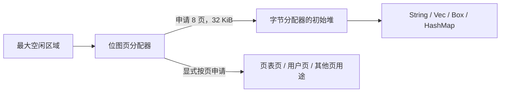
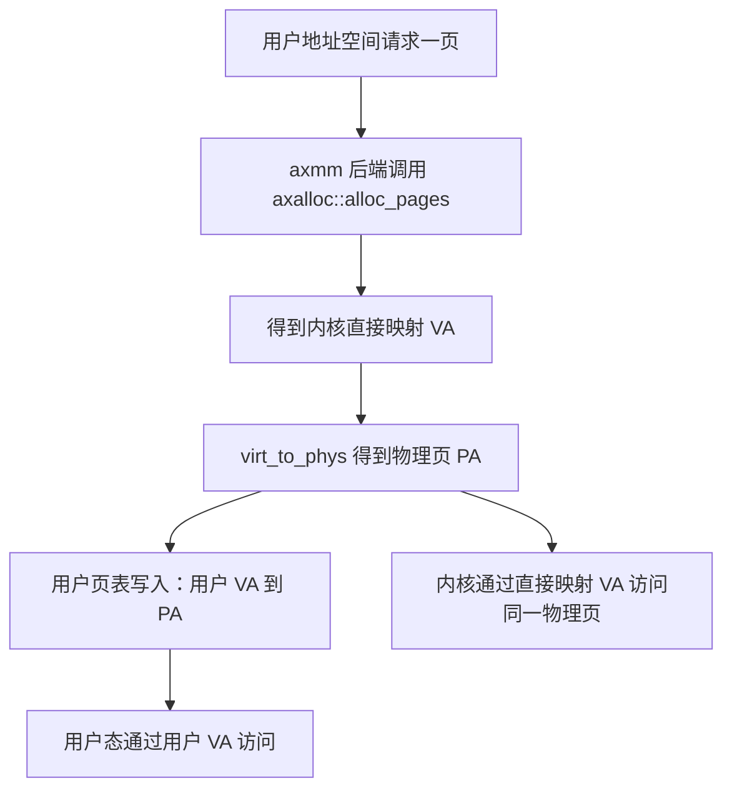

# 从启动到运行：ArceOS 的内存分配机制

本文依据本仓库实现，以 RISC-V QEMU 为例说明启动、内存映射、普通分配器和第三题替代分配器之间的关系。图中的小型地址区间用于演示，除明确标注的平台配置外，不代表实际运行地址。

## 1. 先明确：本项目没有自动切换分配器

`EarlyAllocator` 的名字表示它适合启动早期使用，其源码注释也描述了“正式分配器工作前提供分配”的用途。但是本仓库的实际接线是两条按 feature 选择的路径：

| 配置 | 初始化的全局分配器 | 应用运行时使用的算法 |
| --- | --- | --- |
| `axstd/alloc` | `axalloc::GlobalAllocator` | 默认 TLSF 字节分配器 + 位图页分配器 |
| `axstd/alt_alloc` | `alt_axalloc::GlobalAllocator` | 包装 `EarlyAllocator`，两端游标分配 |
| 两项都不开启 | 不通过这两条路径初始化堆 | 应用不能依赖这两套全局堆分配能力 |

第三题的 `alt_alloc` 练习属于第二条路径：启动时初始化 `EarlyAllocator`，应用的 `Vec` 也继续使用它，并不会在某个阶段切换成 TLSF。

普通分配路径也不会先调用 `EarlyAllocator`。所谓“early → 正式”的交接是可以采用的设计模式，不是本项目已经实现的启动步骤。


两项不能视为可同时启用的主备分配器：它们会重复定义启动初始化函数，并在裸机构建中尝试注册不同的全局分配器。Cargo feature 又是累加的，因此需要关注上层功能是否间接启用了普通 `alloc`。

## 2. 启动最早阶段：没有堆也能执行代码

[RISC-V 启动代码](../arceos/modules/axhal/src/platform/riscv64_qemu_virt/boot.rs) 已通过静态声明准备：

```rust
static mut BOOT_STACK: [u8; TASK_STACK_SIZE] = [0; TASK_STACK_SIZE];
static mut BOOT_PT_SV39: [u64; 512] = [0; 512];
```

它们随内核镜像和链接布局获得存储，不需要先通过 `Vec` 或 `Box` 申请空间。启动汇编设置栈指针，填写静态启动页表，启用 MMU，然后跳到内核高虚拟地址。

```text
启动时已经存在的存储
┌──────────────────────────────────────────┐
│ 内核代码 / 数据 / BSS / 静态启动栈 / 静态页表 │
└──────────────────────────────────────────┘
              不依赖动态堆分配
```

函数局部变量可以使用栈，固定大小数据可以放在静态存储中。因此“堆还没初始化”并不等于“程序没有内存可用”。这一阶段不能提前调用需要动态分配的接口。

随后 [rust_entry()](../arceos/modules/axhal/src/platform/riscv64_qemu_virt/mod.rs) 清理 BSS，初始化 CPU、异常入口和早期时钟，再进入 `axruntime::rust_main()`。

## 3. 进入运行时：发现空闲内存并初始化堆

[axruntime/src/lib.rs](../arceos/modules/axruntime/src/lib.rs) 的主要顺序如下，部分步骤由 feature 控制：

```text
rust_main
  1. 输出启动信息、初始化日志
  2. 枚举物理内存区域
  3. init_allocator：初始化本次构建选择的分配器
  4. 若开启 paging：建立更细粒度的内核页表
  5. 初始化平台设备
  6. 若开启 multitask：初始化调度器
  7. 按需初始化驱动、文件系统、网络等
  8. 按需启动其他 CPU、中断和 TLS
  9. 调用应用 main
```

注意：第 4 步不是第一次启用地址转换。RISC-V 启动阶段已经有粗粒度页表，所以第 3 步可以通过内核虚拟地址访问内存；之后再利用已可用的分配器创建精细页表。

### 3.1 哪些内存可以交给分配器

`memory_regions()` 组合内核镜像区域与平台区域。初始化函数只选择带 `MemRegionFlags::FREE` 的区域，不会把内核代码、栈和其他已保留区域当作空闲内存。

```text
物理内存示意
低地址                                                      高地址
| 固件等保留空间 | 内核镜像、静态栈等 |      FREE 空闲区域      |
                                      ↓
                                交给分配器管理
```

两条初始化路径都会先找到最大的 FREE 区域，用它调用 `global_init()`，再把其他 FREE 区域交给 `global_add_memory()`。

### 3.2 为什么传进去的是虚拟地址

初始化使用：

```rust
global_init(phys_to_virt(r.paddr).as_usize(), r.size);
```

RISC-V QEMU 配置的直接映射偏移为 `0xffff_ffc0_0000_0000`，所以分配器保存和返回的地址属于内核直接映射区域。

```text
空闲区域 PA ── 加固定偏移 ──> 内核 VA
                                 ↓
                         分配器在该区域切分空间
                                 ↓
                         返回能作为指针访问的 VA
```

分配器负责空间归属；页表负责地址映射。这里不是向另一个操作系统申请内存，而是在 ArceOS 已经掌握的空闲 RAM 中划分空间。

## 4. 普通路径：正式分配器如何初始化

[axalloc::GlobalAllocator](../arceos/modules/axalloc/src/lib.rs) 内部包含两个独立加锁的对象：

```rust
pub struct GlobalAllocator {
    balloc: SpinNoIrq<DefaultByteAllocator>,
    palloc: SpinNoIrq<BitmapPageAllocator<PAGE_SIZE>>,
}
```

`PAGE_SIZE = 4096`，`MIN_HEAP_SIZE = 0x8000`，即 32 KiB。初始化步骤是：

1. 将最大空闲区域交给位图页分配器。
2. 从页池申请连续 8 页，共 32 KiB。
3. 将这 8 页交给字节分配器，作为初始堆。



此过程不依赖 `EarlyAllocator`。页分配器自身的位图结构包含在其对象中，包装对象也是预先创建的静态实例；初始字节堆直接由页池提供，避免了“必须先有字节堆才能初始化字节堆”的循环。

### 4.1 页池与字节堆是上下级关系

假设页池包含 16 页。以下把初始堆画在低端，仅用于展示关系，不依赖具体选页结果：

```text
初始化页池后：
页号   0  1  2  3  4  5  6  7  8  9 10 11 12 13 14 15
状态   F  F  F  F  F  F  F  F  F  F  F  F  F  F  F  F

建立 32 KiB 初始字节堆后：
状态   H  H  H  H  H  H  H  H  F  F  F  F  F  F  F  F
       └──── 字节堆拥有的 8 页 ────┘

F：页池中的空闲页；H：页池已分配给字节堆的页
```

再放大字节堆内部：

```text
|           由 8 页组成的字节堆，合计 32 KiB           |
| 管理信息 / 对齐 | 对象 A | 空闲块 | 对象 B | 其他空间 |
```

对象可能小于一页，也可能跨越多页。页池只知道这 8 页已交给字节堆，不记录里面有几个 `String`；字节分配器负责更细的对象划分。

### 4.2 默认为什么是 TLSF

[axalloc/Cargo.toml](../arceos/modules/axalloc/Cargo.toml) 定义 `default = ["tlsf"]`，代码还允许选择 slab 或 buddy 字节分配算法。当前类型选择分支按 slab、buddy、tlsf 的顺序判断，不能简单把多个算法 feature 累加理解为同时运行多个字节分配器。

TLSF 按块大小组织空闲块，处理查找、切分和释放复用。它不会像第三题那样只靠一个向右移动的字节游标来管理整个堆。

## 5. 普通路径：申请、扩容与释放时发生什么

### 5.1 字节申请

以 `Vec` 或哈希表申请缓冲区为例：

```text
容器确定 Layout（大小、对齐）
    → Rust 全局分配接口
    → axalloc 的 GlobalAlloc 实现
    → GlobalAllocator::alloc
    → 锁住字节分配器并查找合适的空闲块
    → 返回内核 VA
```

分配后的示意变化：

```text
之前：|                  空闲块                  |
之后：| 管理及对齐开销 | A：100 字节 | 剩余空闲块 |

再申请 B：
      | 开销 | A | 开销 | B：6000 字节，可能跨页 | 空闲 |
```

图中块位置和开销是概念示意，实际取决于算法、地址与对齐，不代表精确布局。

### 5.2 字节堆不足时，由页池扩展

`GlobalAllocator::alloc()` 会在字节分配失败后计算扩展大小：

```rust
let expand_size = old_size
    .max(layout.size())
    .next_power_of_two()
    .max(PAGE_SIZE);
```

然后从页池申请 `expand_size / PAGE_SIZE` 页，交给 `balloc.add_memory()`，再重试字节分配。例如堆总量为 32 KiB，请求 40 KiB 时，扩展大小为 64 KiB，即 16 页；实际可否完成仍取决于页池和字节分配器的空间、对齐及管理开销。

```text
扩展前：
页池：| H H H H H H H H | F F F F F F F F ... |
字节堆：池 A（32 KiB）

扩展后：
页池：| H H H H H H H H | H H H H H H H H ... | 剩余 F |
字节堆：池 A（32 KiB） + 新增池 B（示例 64 KiB）
```

新增池不要求紧挨原池，不能将其理解为一个连续游标直接跨过中间内存。分配器会管理加入的内存池。

若系统还有其他 FREE 区域，当前 `axalloc::global_add_memory()` 将它们直接加入字节分配器，而不是追加到位图页池。这是本仓库实现中的一项具体选择。

### 5.3 释放字节块

```text
释放前：| A | B | C | 空闲 |
释放 B：| A | 可复用空闲块 | C | 空闲 |
```

TLSF 可以在其他对象仍存活时回收 B，供后续申请复用。但外层 `axalloc::dealloc()` 只把对象交还字节分配器，没有把整个堆池归还页池的步骤。

因此即使堆中对象都释放，曾分配给堆的页也不自动变成页池空闲页。字节层面的空闲和页层面的空闲，需要分别理解。

### 5.4 显式页申请

`global_allocator().alloc_pages(n, align)` 直接使用位图页分配器，不经过字节分配器。位图跟踪哪些页可用，并寻找满足请求的页范围。

```text
之前：| H H H H H H H H | F F F F F F F F |
申请页后：
      | H H H H H H H H | P P | F F F F F F |
                           ↑ 保留给页接口调用者
```

`P` 可以用作页表或数据页，具体用途由调用者决定。返回值仍是内核直接映射 VA；页表项需要 PA 时再做转换。

`dealloc_pages()` 会调用底层页分配器的释放接口。具体释放范围行为取决于所用 `allocator` 依赖实现，不能从包装层就推断所有多页释放细节；这与第三题明确不回收页的策略不同。

## 6. 替代路径：EarlyAllocator 如何改变地址分配

第三题选择 `axstd/alt_alloc`，通过 [alt_axalloc](../arceos/modules/alt_axalloc/src/lib.rs) 将 [EarlyAllocator](../arceos/modules/bump_allocator/src/lib.rs) 注册为全局分配器。

它没有独立的页池和字节堆。两种接口直接共享同一段连续区域，从两端向中间分配：

```text
低地址                                                       高地址
start                byte_pos               page_pos           end
  | 已保留字节区域      |       空闲区域        | 已保留页区域      |
                        →                   ←
```

### 6.1 地址变化示例

假设初始化区域为 `[0x1000, 0x9000)`，共 8 页，每页 `0x1000` 字节。

**状态 0：刚初始化**

```text
0x1000                                                   0x9000
   |                     全部空闲                           |
   ↑                                                       ↑
byte_pos                                                page_pos
```

**状态 1：申请 A，24 字节，对齐 8**

```text
0x1000  0x1018                                          0x9000
   | A |                    空闲                           |
       ↑                                                   ↑
    byte_pos                                            page_pos
```

返回 `0x1000`，`allocations = 1`。

**状态 2：申请 1 页，按 4096 字节对齐**

```text
0x1000  0x1018                           0x8000          0x9000
   | A |               空闲                | 页 P：4096 字节 |
       ↑                                   ↑
    byte_pos                            page_pos
```

页接口返回 `0x8000`。这只保留一页内存，没有建立任何用户映射。

**状态 3：申请 B，16 字节，对齐 64**

```text
0x1000 0x1018  0x1040 0x1050             0x8000          0x9000
   | A | 对齐间隙 | B |      空闲           |      页 P       |
                      ↑                    ↑
                   byte_pos             page_pos
```

返回 `0x1040`，`byte_pos = 0x1050`，`allocations = 2`。对齐间隙也暂时包含在低端保留区域内。

**状态 4：只释放 A**

```text
   | A 的空洞 | 对齐间隙 | B |      空闲      | 页 P |
                           ↑                ↑
                       byte_pos          page_pos
```

`allocations = 1`，游标不变。因为不管理单个空洞，新申请仍从 B 后面开始。

**状态 5：再释放 B，字节块全部释放**

```text
0x1000                                  0x8000          0x9000
   |              可重新分配的空间          |      页 P       |
   ↑                                       ↑
byte_pos                                page_pos
```

`allocations = 0`，`byte_pos` 重置为 `start`。页 P 仍被保留，因为这里的 `dealloc_pages()` 是空操作，页不会回收。

### 6.2 字节区域也由页组成

不要把图中的字节区域理解为“不是页的内存”。整段内存都由底层物理页支撑，只是接口采用不同的切分粒度：

```text
底层页边界：|    页 0    |    页 1    |    页 2    | ... |
字节切分：  | 小对象 A |       跨两页的对象 B       | ... |
```

一个字节对象可以跨页，一页也可以放多个小对象。`EarlyAllocator` 通过检查两个游标是否相撞，避免字节请求和页请求使用同一片内存。

与正式分配器不同，它不是先从页池拿几页再建立字节堆，而是两个接口直接推进共享区域的边界。

### 6.3 为什么叫 early，以及为什么这里持续使用它

早期分配器常用于复杂分配器准备好之前：状态少、初始化简单、不需要动态创建空闲链表等结构。但它回收能力有限，不适合任意长期分配与释放负载。

第三题为了练习替代全局分配器，将它放在 `alt_axalloc` 后面持续使用。这是练习的接入方式，不表示普通 ArceOS 启动都需要经过它。

`add_memory()` 也不会新建分配器，只会初始化或扩展当前对象。由于它只有一对游标，只支持满足条件的连续边界扩展；不能像普通字节分配器那样任意加入不连续内存池。

## 7. 页分配和用户地址空间的关系

分配一页和建立用户映射是两步：



[axmm 的分配映射后端](../arceos/modules/axmm/src/backend/alloc.rs) 当前使用普通 `axalloc`。它的 `alloc_frame()` 申请页、转换为 PA，再由页表映射到选定的用户 VA。

所以不能看到 `EarlyAllocator::alloc_pages()` 就判断它属于用户地址空间。底层分配器只保留内存，用途由上层决定。地址转换细节见[物理地址与虚拟地址转换](address-translation.md)。

## 8. 全局注册和锁负责什么

两种包装器都实现 `core::alloc::GlobalAlloc`，并在裸机非测试构建中通过 `#[global_allocator]` 注册静态对象。

```text
注册：Rust 的堆请求交给哪个静态对象
初始化：这个对象可以管理哪些内存
分配算法：如何找到可用空间
锁：如何避免并发修改分配器状态
页表：返回地址如何对应物理内存、允许哪些访问
```

这些职责需要分别理解。`SpinNoIrq` 让共享的全局对象能够安全地修改内部状态，避免并发分配破坏管理信息；它不会自动让使用这些内存的 `HashMap` 等对象支持并发修改。

## 9. 两种分配器的对照

| 问题 | 普通 axalloc | 第三题 EarlyAllocator |
| --- | --- | --- |
| 启用入口 | `axstd/alloc` | `axstd/alt_alloc` |
| 字节算法 | 默认 TLSF，可配置其他实现 | 对齐后向高地址推进游标 |
| 页算法 | 位图页分配 | 从高端向低地址推进游标 |
| 字节层与页层关系 | 页池给字节堆供给空间 | 两端共享同一连续区域 |
| 释放单个字节对象 | 可供字节分配器复用 | 仅减少计数，全部释放才整体回退 |
| 字节堆扩展 | 从页池申请内存并加入字节堆 | 没有自动向另一个页池申请的过程 |
| 是否自动切换 | 不切换到 EarlyAllocator | 不切换到 TLSF |
| 是否自动建立用户映射 | 否 | 否 |
| 返回地址 | 内核直接映射 VA | 内核直接映射 VA |

## 10. 阅读代码的顺序

1. [RISC-V boot.rs](../arceos/modules/axhal/src/platform/riscv64_qemu_virt/boot.rs)：静态启动栈、启动页表、进入高地址。
2. [axruntime/src/lib.rs](../arceos/modules/axruntime/src/lib.rs)：初始化顺序和两套 feature 分支。
3. [axalloc/src/lib.rs](../arceos/modules/axalloc/src/lib.rs)：普通分配器的初始堆、按页扩展与全局接口。
4. [alt_axalloc/src/lib.rs](../arceos/modules/alt_axalloc/src/lib.rs)：替代分配器注册与锁包装。
5. [bump_allocator/src/lib.rs](../arceos/modules/bump_allocator/src/lib.rs)：游标算法、对齐、回收和连续扩展限制。
6. [axhal/src/paging.rs](../arceos/modules/axhal/src/paging.rs) 与 [axmm/src/backend/alloc.rs](../arceos/modules/axmm/src/backend/alloc.rs)：页表页和用户数据页如何使用普通页分配接口。

本文是对当前实现的代码说明；地址演示用于解释算法，不是新增运行测试的日志。
